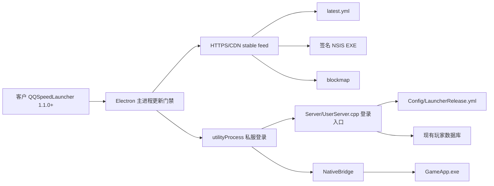

# QQSpeed Launcher 客户发布、强制自动更新与性能修复实施计划

> **For agentic workers:** REQUIRED SUB-SKILL: Use `superpowers:subagent-driven-development` (recommended) or `superpowers:executing-plans` to implement this plan task-by-task. Steps use checkbox (`- [ ]`) syntax for tracking.

**Goal:** 交付最后一次需要人工发送的 `1.1.0` 安装包；从 `1.1.1` 开始由登录器自动检查、下载并强制安装更新，同时修复已确认的数据安全、启动延迟、内存和发布门禁问题。

**Architecture:** 第一阶段保留 Electron + NSIS，以 `electron-updater` 实现最短可落地的强制更新闭环：单一窗口先加载轻量 `update.html` 更新壳，主进程门禁所有登录/GameApp IPC，只有确认当前版本为最新版本后才导航到正式登录页。第二阶段再引入独立 Rust Bootstrap、版本目录、健康检查和原子回滚；现有每次完整解压的 Portable SFX 不作为正式更新器。

**Tech Stack:** Windows x64、Electron 43、Node.js、JavaScript ESM/CJS、electron-builder NSIS、electron-updater、Koffi、MSVC x64 C++、Rust x86_64-pc-windows-msvc、Windows Authenticode、HTTPS 静态更新源。

## Global Constraints

- 项目根目录：`F:\PacketDumpTool\21487\server\LauncherElectron`。
- 第一版更新能力测试版本固定为 `1.1.0-rc.1`，正式版固定为 `1.1.0`；升级验证目标固定为 `1.1.1`。
- 保留并冻结现有 `appId: local.qqspeed.launcher`，避免已安装的 `1.0.1` 失去升级识别；`productName`、快捷方式名和 stable channel 同时冻结。
- 第一阶段只发布 NSIS 安装版；Portable 不进入客户正式发布链。
- 客户版默认采用低内存平衡策略：登录前不启动 GameApp；登录成功且更新门禁通过后才预热 GameApp。不要用错误文案宣称“打开登录器已经预载 GameApp”。
- 强制更新采用 fail-closed：安装态无法确认版本最新时，不允许登录、native session、GameApp 或多开；只允许重试或退出。
- 窗口必须先显示轻量更新壳，不得为了网络检查破坏现有约 471ms 的首屏中位数。
- 自动更新、安装包和所有 PE 必须使用同一受控 Windows 代码签名发布者；无有效签名不得发布。
- 更新源必须为 HTTPS，支持 Range、正确的 `Content-Length`；版本化文件 immutable，`latest.yml` 使用 `no-cache` 或极短 TTL。
- 更新和业务日志不得记录账号、密码、GameKey、SignKey、更新私钥、证书密码或 release material。
- `F:\PacketDumpTool\21487\server\Server\build\release-material\LauncherReleaseMaterial.generated.inc` 禁止提交、复制到文档或打印内容。
- 每个任务先写失败测试，再做最小实现，再运行定向测试；一次只改一个风险面。
- 所有删除操作都必须在 Git 基线、Git LFS 对象和外部备份确认可恢复后单独批准；执行本计划时不得顺手删除用户数据或历史证据。

---

## 决策摘要与执行顺序

1. 建立 Git/LFS 可回滚基线，暂不清理目录。
2. 先修正测试与真实 PE-resource 301 打包契约，保证门禁可信。
3. 修复 JSON 覆盖、固定 5 秒等待、远端内容阻塞、bundle/RSA/媒体内存问题。
4. 单独升级 Electron 35.7.5 到 43.1.1；不同时升级 Koffi、fuses、asar。
5. 接入 `electron-updater@6.8.9`，主进程建立强制更新状态机和 IPC 门禁。
6. 改为 NSIS normal 压缩、blockmap 差分、HTTPS feed 和 Authenticode 签名。
7. 用两套真实签名安装包完成 `1.1.0 -> 1.1.1` 升级验证。
8. 人工发送一次 `1.1.0`；从 `1.1.1` 开始自动更新。
9. 连续两个自动更新版本稳定后，再实施独立 Rust Bootstrap 和原子回滚。
10. 公网扩大客户前完成服务端连接池 ownership/上限修复和 Launcher 登录限流；密码/TLS 迁移单独发布。
11. 官服函数级逆向作为平行证据工作流，不阻塞已经由运行日志证明的上线行为；未完成部分不得宣称“全部反编译完成”。

---

## 上线范围、当前事实与完成边界

这不是“先发一个 EXE，出问题再补”的发布。上线目标同时包含客户端、登录服务、更新源、签名、两版本升级验证和回滚能力。任意一项没有通过，均不得把版本发给客户。

### 当前已经从文件和现有制品确认的事实

| 项目 | 当前证据 | 上线结论 |
|---|---|---|
| 当前版本 | `package.json` 为 `1.0.1` | 不复用版本号；更新能力从 `1.1.0` 开始 |
| 源码基线 | `LauncherElectron` 当前不是 Git 仓库 | P0 阻断；任何清理和修改前先建基线 |
| 打包格式 | NSIS x64，`compression: store` | 改为 `normal`，否则安装包和全量更新体积过大 |
| 差分更新 | `differentialPackage: false` | 改为 `true`，生成 `.blockmap` |
| 更新能力 | 没有 `electron-updater` 和 `publish` 配置 | P0 阻断；当前版本不会自动更新 |
| 代码签名 | 当前安装包 Authenticode 为 `NotSigned` | P0 阻断；客户正式包必须签名 |
| 安装身份 | `src/build/installer.nsh` 在每次安装删除 `install-secrets` | P0 阻断；覆盖更新必须保留安装身份 |
| 正式 runtime | 当前真实打包方式是主 EXE 的 PE resource `301` | 发布 smoke 必须只验证这一真实契约 |
| 陈旧发布代码 | Portable/部分 smoke 仍假设 bundle 位于 ASAR | 移出正式发布链或改写，不得混用两套事实 |
| 登录协议入口 | 客户端 `private-login-client.js`；服务端 `Server/UserServer.cpp::MyRequestGetUin` | 最低版本门禁在此协议上实现 |
| 服务端数据库 | 服务端已有 MySQL/ConnectionPool 代码 | 首次上线不使用数据库保存发布策略 |
| GameApp 时序 | 现有文档和实现以“打开即预载”为主 | 客户版改成登录前不启动，降低登录页内存 |
| 官服证据 | 早期隔离观察未提交账号，但后续官服主日志已证明成功 SSO/PT 登录和 Game started；更新故障分支仍未动态注入 | 按证据时间勘误旧报告，已证明与待验证分开标注 |

### 上线后客户实际看到的完整行为

```text
双击 QQSpeedLauncher
  -> 约 1 秒内显示窗口和“正在检查更新”轻量页面
  -> 主进程从 HTTPS 更新源检查 stable channel
     -> 无更新：主进程导航到登录页；GameApp 尚未启动
     -> 有更新：自动下载并显示进度；登录和 GameApp 全部锁定
     -> 下载完成：自动退出、安装、重启新版本
     -> 检查/下载/签名失败：只允许重试或退出
  -> 用户提交账号密码
  -> 登录请求携带 launcherVersion/channel/platform/arch
     -> 服务端版本不支持：返回 UPDATE_REQUIRED，主进程导航回更新页
     -> 凭据错误：停留登录页，不启动 GameApp
     -> 认证成功：才创建并预热 GameApp，写入一次性认证材料
  -> 主进程发布权威 UserLogin，进入主页
  -> 用户点击“开始游戏”
  -> 放行同一个已认证 GameApp，登录器最小化
```

### 最终生产架构



边界固定如下：

- 客户端不直连数据库；客户端只调用更新源和登录服务。
- CDN 只存不可变安装包、blockmap 和短缓存 manifest，不存账号数据。
- `LauncherRelease.yml` 只保存发布策略，不保存凭据、证书或 release material。
- 玩家数据库继续只负责账号和游戏数据；`1.1.0` 上线不增加版本策略表。
- 登录器 renderer 不能自行解除门禁；main 和 utility/native IPC 都必须执行相同检查。

### 开工前必须由发布负责人确定的外部输入

这些值不能从源码可靠推断，也不能由实现者自行编造：

| 输入 | 要求 | 未提供时可做什么 |
|---|---|---|
| `QQSPEED_UPDATE_BASE_URL` | 正式 HTTPS stable feed，支持 Range | 可完成代码和本地假 feed 测试，不能正式发布 |
| `QQSPEED_UPDATE_FALLBACK_URL` | 运维侧备用源；通过同一正式 hostname 的源站切换/DNS 恢复，不由 renderer 改 feed | 可先单源 RC，不能开启大规模 fail-closed |
| `QQSPEED_WINDOWS_PUBLISHER` | 与证书 Subject 完全一致 | 可打未签名开发包，不能交付客户 |
| `CSC_LINK` / `CSC_KEY_PASSWORD` | 只通过受控 CI secret 注入 | 不得写入仓库、日志或 MD |
| 现有客户安装版本 | 是否已经安装过 `1.0.1`、安装目录和 appId | 未确认前冻结当前 `appId`，禁止迁移 |
| 服务端发布窗口 | 可重启时间、二进制替换方式、回滚负责人 | 可完成离线构建，不能切生产门禁 |
| 客户分组方式 | 内部、5%、25%、100%名单或渠道 | 无分组能力时只能人工小批次发放 |
| 支持的 Windows 基线 | x64、标准用户、代理/无代理、系统版本范围 | 至少以干净标准用户 VM 作为硬门禁 |

### Go/No-Go 总门禁

以下全部为 **Go** 才能给客户：

- [ ] 源码和二进制已有可恢复 Git tag/LFS/外部备份。
- [ ] `npm run check`、单元测试、native build、packaged/release smoke 全部通过。
- [ ] 服务端先上线并在 `acceptLegacyClients: true` 时兼容旧请求。
- [ ] `1.1.0` 和 `1.1.1` 均使用相同发布者证书有效签名。
- [ ] 干净标准用户 VM 完成真实 `1.1.0 -> 1.1.1` 自动升级。
- [ ] 断网、代理、超时、损坏 blockmap、错误签名、下载中断均不会绕过登录/GameApp 门禁。
- [ ] 更新前后账号 metadata、DPAPI vault、设置和安装身份保持一致。
- [ ] 服务端 `UPDATE_REQUIRED` 与客户端导航回轻量更新页完成端到端验证。
- [ ] HTTPS 主源和备用源从客户网络可访问，Range/hash/缓存符合要求。
- [ ] 已准备上一份有效 manifest、修复版递增版本和人工修复安装包流程。
- [ ] 支持人员拿到客户操作说明、日志收集方式和回滚联系人。

只要有一项是 **No-Go**，就继续在 RC/内部环境处理，不得把“能打包”误称为“能上线”。

---

### Task 0: 统一服务端唯一构建和部署真相

**Files:**
- Create: `F:\PacketDumpTool\21487\server\LauncherElectron\docs\SERVER-BUILD-TRUTH.md`
- Modify: `F:\PacketDumpTool\21487\server\Server\SpeedServer.sln`
- Modify: `F:\PacketDumpTool\21487\server\LauncherElectron\src\scripts\build-native.cjs`
- Modify: `F:\PacketDumpTool\21487\server\LauncherElectron\test\unit\native-build-memory-only.test.js`
- Review only: `F:\PacketDumpTool\21487\server\Server\Server.vcxproj`
- Review only: `F:\PacketDumpTool\21487\server\Server\SpeedServer.vcxproj`
- Review only: `F:\PacketDumpTool\21487\server\Server\Server.cpp`

**Interfaces:**
- Consumes: 当前冲突的两套 VCXPROJ、一个只引用旧项目的 SLN、Launcher release build script 和实际部署启动证据。
- Produces: 唯一 canonical target `Server.vcxproj -> bin\QQSpeedServer.exe`，以及不再自动误选旧项目的构建链。

当前冲突必须先公开记录：

```text
SpeedServer.sln -> SpeedServer.vcxproj -> bin/SpeedServer.exe
LauncherElectron build-native.cjs -> Server.vcxproj -> bin/QQSpeedServer.exe
Server.cpp 不在两套当前 compile item 中，且重复 main/全局对象，属于残留候选
```

本计划选择较新的 release-material 构建链 `Server.vcxproj -> QQSpeedServer.exe` 作为上线 canonical target；但切换生产前必须先从实际服务包装器、进程命令行或部署脚本证明当前线上启动的是哪个 EXE，并完成同配置行为回归。

- [ ] **Step 1: 写冲突检测失败测试**

测试必须在以下情况失败：

```text
solution 仍引用 SpeedServer.vcxproj
build-native 自动发现多个部署项目
canonical project 不编译 UserServer.cpp/Message.cpp/LauncherRuntimeMaterial.cpp
canonical output 不是 bin/QQSpeedServer.exe
Server.cpp 被重新加入 compile item
```

- [ ] **Step 2: 记录切换前运行证据**

在真实部署主机执行：

```powershell
Get-CimInstance Win32_Process |
  Where-Object { $_.Name -in @('QQSpeedServer.exe','SpeedServer.exe') } |
  Select-Object ProcessId,Name,ExecutablePath,CommandLine,CreationDate

Get-CimInstance Win32_Service |
  Where-Object { $_.PathName -match 'QQSpeedServer|SpeedServer' } |
  Select-Object Name,State,StartMode,PathName

Get-ScheduledTask |
  Where-Object { $_.Actions.Execute -match 'QQSpeedServer|SpeedServer' } |
  Select-Object TaskName,State,Actions
```

若三处均无证据，发布负责人必须提供当前启动 wrapper；不能只凭文件名猜测线上程序。

- [ ] **Step 3: 先并行构建并比较，再统一 solution**

```powershell
$msbuild='C:\Program Files\Microsoft Visual Studio\2022\Community\MSBuild\Current\Bin\MSBuild.exe'
& $msbuild 'F:\PacketDumpTool\21487\server\Server\SpeedServer.vcxproj' /m /t:Build /p:Configuration=Release /p:Platform=x64
& $msbuild 'F:\PacketDumpTool\21487\server\Server\Server.vcxproj' /m /t:Build /p:Configuration=Release /p:Platform=x64
```

使用同一份 `bin\Config` 完成登录 MsgID 1、runtime material MsgID 3、GameServer ready 和数据库连接回归。只有 canonical 行为不回退，才把 `SpeedServer.sln` 的 project reference 改为 `Server.vcxproj`。

- [ ] **Step 4: 让构建脚本只接受 canonical project**

`build-native.cjs` 默认应从仓库相对路径解析 `..\Server\Server.vcxproj`；环境变量只允许显式指向同一 realpath，不再递归扫描其他目录。CI 仍记录 resolved path，但云构建不写死 `F:` 盘符。

- [ ] **Step 5: 保留而不删除旧项目和残留源码**

本次只在 `SERVER-BUILD-TRUTH.md` 标记：

```text
SpeedServer.vcxproj = legacy build definition，禁止 production
Server.cpp = uncompiled residual candidate，禁止作为当前运行证据
Server.vcxproj = production canonical target
```

旧文件只有在 Git 基线、行为回归和至少一个正式版本稳定后，才能另开清理任务删除。

- [ ] **Step 6: 验证并提交**

```powershell
cd F:\PacketDumpTool\21487\server\LauncherElectron
node --test test/unit/native-build-memory-only.test.js
$env:QQS_SPEED_SERVER_PROJECT='F:\PacketDumpTool\21487\server\Server\Server.vcxproj'
npm run check:native-build
git add docs/SERVER-BUILD-TRUTH.md src/scripts/build-native.cjs test/unit/native-build-memory-only.test.js
git commit -m "build: select one production server target"
```

服务端 solution 改动在服务端仓库单独提交，不能混入 Launcher commit。

---

### Task 1: 建立可回滚的源码基线

**Files:**
- Modify: `F:\PacketDumpTool\21487\server\LauncherElectron\.gitignore`
- Create: `F:\PacketDumpTool\21487\server\LauncherElectron\.gitattributes`
- Create: `F:\PacketDumpTool\21487\server\LauncherElectron\src\scripts\smoke-workspace-hygiene.cjs`
- Modify: `F:\PacketDumpTool\21487\server\LauncherElectron\package.json`

**Interfaces:**
- Consumes: 当前未受 Git 管理的完整工程树。
- Produces: 本地 Git main 分支、Git LFS 二进制指针、`baseline/pre-release-1.0.1` 标签，以及可重复的 workspace hygiene 检查。

- [ ] **Step 1: 写 workspace hygiene 失败测试**

`smoke-workspace-hygiene.cjs` 必须读取 `.gitignore`、`.gitattributes`，断言存在以下规则：

```js
const requiredIgnores = [
  '.codex-backups/',
  'native/NativeBridge/.vs/',
  'native/NativeBridge/build/',
  'native/portable-x64-bootstrap/target/',
  '*.obj', '*.user', '*.suo', '*.VC.db', '*.VC.VC.opendb',
  '*.ipch', '*.pdb', '*.ilk', '*.tlog', '*.lastbuildstate'
];

const requiredLfs = [
  'resources/native/*.dll',
  'resources/native/*.bundle',
  'src/renderer/assets/*.TTF'
];
```

- [ ] **Step 2: 运行测试并确认失败**

```powershell
cd F:\PacketDumpTool\21487\server\LauncherElectron
node .\src\scripts\smoke-workspace-hygiene.cjs
```

Expected: FAIL，至少报告 `.vs/`、`.codex-backups/`、`*.obj` 或 LFS 规则缺失。

- [ ] **Step 3: 补全 ignore 和 LFS 规则**

`.gitattributes` 使用：

```gitattributes
resources/native/*.dll filter=lfs diff=lfs merge=lfs -text
resources/native/*.bundle filter=lfs diff=lfs merge=lfs -text
src/renderer/assets/*.TTF filter=lfs diff=lfs merge=lfs -text
*.md text eol=crlf
*.js text eol=lf
*.cjs text eol=lf
*.mjs text eol=lf
```

在 `package.json` 增加：

```json
"check:workspace": "node src/scripts/smoke-workspace-hygiene.cjs"
```

- [ ] **Step 4: 运行测试并建立 Git 基线**

本机已发现 Git/Git LFS；当前未发现 `gitleaks`。先安装并确认工具可用，再提交：

```powershell
winget install --id Gitleaks.Gitleaks --exact
cd F:\PacketDumpTool\21487\server\LauncherElectron
git init -b main
git lfs install --local
git lfs track "resources/native/*.dll" "resources/native/*.bundle" "src/renderer/assets/*.TTF"
npm run check:workspace
git add -n .
git status --short --ignored
gitleaks detect --no-git --source . --redact --exit-code 1
git add .
git commit -m "chore: establish launcher baseline"
git tag baseline/pre-release-1.0.1
```

Expected: hygiene 与 gitleaks PASS；提交不含 `node_modules`、`dist`、`.vs`、`target`、`.codex-backups`、`probe.obj` 或外部 release material。

- [ ] **Step 5: Commit**

该任务的 commit 已在 Step 4 创建；记录：

```powershell
git show --stat --oneline HEAD
git lfs ls-files
```

---

### Task 2: 让发布测试与当前 PE Resource 301 架构一致

**Files:**
- Modify: `F:\PacketDumpTool\21487\server\LauncherElectron\package.json`
- Modify: `F:\PacketDumpTool\21487\server\LauncherElectron\src\scripts\smoke-packaged.cjs`
- Modify: `F:\PacketDumpTool\21487\server\LauncherElectron\src\scripts\smoke-release.cjs`
- Delete: `F:\PacketDumpTool\21487\server\LauncherElectron\src\scripts\smoke-runtime-artifacts.cjs`
- Create: `F:\PacketDumpTool\21487\server\LauncherElectron\src\scripts\check-source-syntax.cjs`
- Modify: `F:\PacketDumpTool\21487\server\LauncherElectron\test\unit\embedded-native-packaging.test.js`
- Modify: `F:\PacketDumpTool\21487\server\LauncherElectron\test\unit\runtime-packaging-boundary.test.js`
- Create: `F:\PacketDumpTool\21487\server\LauncherElectron\test\unit\source-syntax-coverage.test.js`

**Interfaces:**
- Consumes: `src/build/after-pack.cjs` 和 `src/build/pe-runtime-resource.cjs` 的正式 resource 301 契约。
- Produces: 自动发现全部 JS/CJS/MJS 的语法门禁，以及只验证真实生产打包方式的 packaged/release smoke。

- [ ] **Step 1: 写失败测试**

新增测试必须证明：

```text
syntax checker discovers every js/cjs/mjs under src
syntax checker includes src/main/native-memory-loader.js
packaged smoke reads PE resource 301 instead of an ASAR bundle
release smoke launches asInvoker without RunAs
package release path does not invoke Portable scripts
```

- [ ] **Step 2: 运行测试并确认当前失败**

```powershell
node --test `
  test/unit/source-syntax-coverage.test.js `
  test/unit/embedded-native-packaging.test.js `
  test/unit/runtime-packaging-boundary.test.js
```

Expected: FAIL，指出 `native-memory-loader.js` 漏检、旧 ASAR smoke 或 `RunAs` 仍存在。

- [ ] **Step 3: 实现递归语法检查**

`check-source-syntax.cjs` 递归枚举 `src/**/*.{js,cjs,mjs}`，排序后逐个执行：

```js
spawnSync(process.execPath, ['--check', absolutePath], {
  cwd: ROOT,
  encoding: 'utf8',
  windowsHide: true
});
```

将 `package.json` 的 `check` 简化为：

```json
"check": "node src/scripts/check-source-syntax.cjs"
```

- [ ] **Step 4: 修正 packaged/release smoke**

要求：

- 使用 `readPeRuntimeResource(executablePath, 301)` 读取正式 EXE 内资源。
- 与 `resources/native/qqspeed-runtime.bundle` 做字节一致性校验。
- ASAR 必须不包含 bundle、自定义 DLL、源码、构建脚本或 release material。
- Koffi `koffi.node` 必须只从允许的 unpacked 路径加载。
- `smoke-release.cjs` 使用标准用户 token，不再调用 `Start-Process -Verb RunAs`。
- 第一版客户发布命令只构建 NSIS；Portable 代码保留为历史工具，但不进入 `release:win`。

- [ ] **Step 5: 验证**

```powershell
npm run check
npm test
npm run verify:runtime
npm run check:fuses
npm run check:ipc-trust
```

Expected: PASS。

- [ ] **Step 6: Commit**

```powershell
git add package.json src/scripts test/unit
git commit -m "test: align release gates with embedded runtime resource"
```

---

### Task 3: 修复账号和设置文件的错误覆盖与非原子写入

**Files:**
- Modify: `F:\PacketDumpTool\21487\server\LauncherElectron\src\main\native-core.js`
- Modify: `F:\PacketDumpTool\21487\server\LauncherElectron\test\unit\credential-metadata-storage.test.js`

**Interfaces:**
- Consumes: `launcher-settings.json` 和 metadata-only `launcher-account.json`。
- Produces: `writeJsonAtomically(destination, value)` 私有函数；只对 `ENOENT`/确定格式损坏恢复，真实 I/O 错误原样抛出。

- [ ] **Step 1: 写失败测试**

新增：

```text
real account metadata I/O errors are propagated without repair writes
settings I/O errors are not converted into an empty game root
launcher settings are replaced atomically without temporary residue
```

保留并收紧现有 malformed legacy 测试：只有 `SyntaxError` 或非法 schema 可以生成规范空 metadata；不得留下密码、cipher、secret 或原始损坏备份。

- [ ] **Step 2: 验证当前失败**

```powershell
node --test test/unit/credential-metadata-storage.test.js
```

- [ ] **Step 3: 最小实现**

共用以下原子写模式：

```js
function writeJsonAtomically(destination, value) {
  mkdirSync(dirname(destination), { recursive: true });
  const temporary = `${destination}.${process.pid}.${Date.now()}.tmp`;
  let handle;
  try {
    handle = openSync(temporary, 'wx', 0o600);
    writeFileSync(handle, `${JSON.stringify(value, null, 2)}\n`, 'utf8');
    fsyncSync(handle);
    closeSync(handle);
    handle = undefined;
    renameSync(temporary, destination);
  } finally {
    if (handle !== undefined) {
      try { closeSync(handle); } catch {}
    }
    try { unlinkSync(temporary); } catch {}
  }
}
```

错误分流固定为：

```text
ENOENT -> 默认值
SyntaxError / schema invalid -> 规范化安全恢复
EACCES / EPERM / EIO / EISDIR / 其他 I/O -> 抛出且不写文件
```

- [ ] **Step 4: 验证**

```powershell
node --test test/unit/credential-metadata-storage.test.js
```

Expected: PASS；I/O 失败时原文件不变、无 `.tmp` 残留。

- [ ] **Step 5: Commit**

```powershell
git add src/main/native-core.js test/unit/credential-metadata-storage.test.js
git commit -m "fix: preserve launcher state on storage errors"
```

---

### Task 4: 移除正常路径固定 5 秒的 GameApp replacement 等待

**Files:**
- Modify: `F:\PacketDumpTool\21487\server\LauncherElectron\native\NativeBridge\NativeBridgeProcess.cpp`
- Modify: `F:\PacketDumpTool\21487\server\LauncherElectron\native\NativeBridge\NativeBridgeProcess.h`
- Modify: `F:\PacketDumpTool\21487\server\LauncherElectron\native\NativeBridge\NativeBridge.cpp`
- Modify: `F:\PacketDumpTool\21487\server\LauncherElectron\test\unit\native-remote-manual-map.test.js`
- Modify: `F:\PacketDumpTool\21487\server\LauncherElectron\test\unit\native-boundary.test.mjs`

**Interfaces:**
- Consumes: 已启动 GameApp 进程句柄、Hook payload、SpeedHookCfg mapping。
- Produces: 非阻塞 `ObserveReplacementGameProcess()`；replacement 观察在现有 session gate 循环内完成，不阻塞 `LaunchGameProcess()`。

- [ ] **Step 1: 写失败测试**

新增契约：

```text
initial GameApp preload has no blocking replacement probe
session gate observes replacement processes without delaying preload
replacement migration reuses the authenticated Hook payload
Hook payload is securely cleared when the absolute observation window expires
```

- [ ] **Step 2: 运行定向测试并确认失败**

```powershell
node --test test/unit/native-remote-manual-map.test.js test/unit/native-boundary.test.mjs
```

- [ ] **Step 3: 实现非阻塞观察**

- 从 `LaunchGameProcess()` 移除同步 `FollowReplacementGameProcesses()`。
- 保留单个绝对 5 秒 observation deadline，但不得因迁移次数重置。
- 在 `WaitForSessionGate()` 原有 250ms 等待循环中调用 `ObserveReplacementGameProcess()`。
- 原进程退出或发现替换子进程时，复用现有 PID handoff、mapping 重建和 Hook mapping。
- deadline 到期且无迁移后执行 `ClearHookPayload()`。

- [ ] **Step 4: 构建和动态验证**

```powershell
$env:QQS_SPEED_SERVER_PROJECT='F:\PacketDumpTool\21487\server\Server\Server.vcxproj'
npm run build:native
npm run check:native-boundary
```

动态验收必须从真实 `launcher.log` 证明：无 replacement 时 `ManualMapHookImage success` 到 `GameApp process identity stabilized` 小于 500ms；replacement 路径仍可迁移 PID 并重新注入。仅靠正则测试不能关闭该任务。

- [ ] **Step 5: Commit**

```powershell
git add native/NativeBridge test/unit/native-remote-manual-map.test.js test/unit/native-boundary.test.mjs
git commit -m "perf: observe GameApp replacement without blocking preload"
```

---

### Task 5: 解除远端内容阻塞并限制响应内存

**Files:**
- Modify: `F:\PacketDumpTool\21487\server\LauncherElectron\src\renderer\app.js`
- Modify: `F:\PacketDumpTool\21487\server\LauncherElectron\src\main\launcher-content-service.js`
- Modify: `F:\PacketDumpTool\21487\server\LauncherElectron\test\unit\launcher-content-service.test.js`
- Modify: `F:\PacketDumpTool\21487\server\LauncherElectron\test\unit\official-launcher-app-integration.test.js`

**Interfaces:**
- Consumes: official content fetch、缓存和 fallback。
- Produces: `readBoundedResponseText(response, maxBytes)`；本地状态/路径准备不再 await 远端内容。

- [ ] **Step 1: 写失败测试**

```text
bootstrap starts local state refresh without awaiting remote content
declared oversized content is rejected before opening the body reader
chunked content without content-length cancels above 2 MiB
bounded reader preserves UTF-8 characters split across chunks
```

- [ ] **Step 2: 运行并确认失败**

```powershell
node --test test/unit/launcher-content-service.test.js test/unit/official-launcher-app-integration.test.js
```

- [ ] **Step 3: 实现并行启动和流式读取**

Renderer bootstrap 使用：

```js
void requestLauncherContent('bootstrap');
const state = await refreshState();
```

Reader 必须使用 `response.body.getReader()`、原始 `Uint8Array.byteLength` 计数、超限 `reader.cancel()`，并使用：

```js
decoder.decode(chunk, { stream: true });
```

- [ ] **Step 4: 验证**

```powershell
node --test test/unit/launcher-content-service.test.js test/unit/official-launcher-app-integration.test.js
```

Expected: PASS；远端挂起 3.5 秒时本地状态和路径准备仍立即开始。

- [ ] **Step 5: Commit**

```powershell
git add src/main/launcher-content-service.js src/renderer/app.js test/unit
git commit -m "perf: decouple launcher startup from remote content"
```

---

### Task 6: 降低登录页空闲内存并纠正 GameApp 语义

**Files:**
- Modify: `F:\PacketDumpTool\21487\server\LauncherElectron\src\shared\native-runtime-bundle.js`
- Modify: `F:\PacketDumpTool\21487\server\LauncherElectron\src\main\executable-runtime-resource.js`
- Modify: `F:\PacketDumpTool\21487\server\LauncherElectron\src\main\native-worker.js`
- Modify: `F:\PacketDumpTool\21487\server\LauncherElectron\src\main\install-key-vault.js`
- Modify: `F:\PacketDumpTool\21487\server\LauncherElectron\src\renderer\app.js`
- Modify: `F:\PacketDumpTool\21487\server\LauncherElectron\src\renderer\media-controller.js`
- Modify: `F:\PacketDumpTool\21487\server\LauncherElectron\src\renderer\index.html`
- Modify: `F:\PacketDumpTool\21487\server\LauncherElectron\test\unit\native-runtime-bundle.test.js`
- Modify: `F:\PacketDumpTool\21487\server\LauncherElectron\test\unit\native-worker-memory-contract.test.js`
- Modify: `F:\PacketDumpTool\21487\server\LauncherElectron\test\unit\install-key-vault.test.js`
- Modify: `F:\PacketDumpTool\21487\server\LauncherElectron\test\unit\renderer-content.test.js`

**Interfaces:**
- Consumes: EXE PE resource 301、一次性 runtime content key、安装身份、当前媒体描述。
- Produces: 176-byte header-only pre-login context；登录时再读取完整 bundle；异步 RSA；活跃视图单媒体加载。

- [ ] **Step 1: 写失败测试**

新增：

```text
packaged start-session retains metadata but no full runtime bundle Buffer
authentication reopens and verifies the full bundle before decoding
full bundle bytes are zeroed on all branches
default install identity generation uses asynchronous crypto API
inactive view video has no src until active
switching views loads at most one video source
launcher open does not spawn GameApp before accepted credentials
rejected credentials never call BeginSession or read the full runtime bundle
successful private authentication calls BeginSession before ApplyAuth
login failure after BeginSession cancels the native session and clears all material
```

- [ ] **Step 2: 运行定向测试并确认失败**

```powershell
node --test `
  test/unit/native-runtime-bundle.test.js `
  test/unit/native-worker-memory-contract.test.js `
  test/unit/install-key-vault.test.js `
  test/unit/renderer-content.test.js
```

- [ ] **Step 3: 只预读 bundle header**

- 导出 `RUNTIME_BUNDLE_HEADER_SIZE = 176`。
- 新增 `inspectNativeRuntimeBundleHeader(header, totalSize)` 和 `readEmbeddedRuntimeBundleHeader()`。
- `nativeContext` 登录前只保留 metadata、resource size、vault、identity。
- 登录取得一次性 key 后重新读取完整资源，并再次校验 bundleId、size、hash 和总长度；所有成功/失败分支在 `finally` 清零 full buffer。

- [ ] **Step 4: RSA 和媒体懒加载**

- 将 `generateKeyPairSync('rsa', 2048)` 改为 Promise 包装的异步 `generateKeyPair`，保持 RSA-OAEP-SHA256、PKCS8、DPAPI 和清零契约不变。
- video/audio 全部使用 `preload="none"`。
- 离开视图时 `pause()`、移除 `src`、调用 `load()`；只为活跃视图附加 allowlist 后的 source。
- 更新门禁 `ready` 之前不创建 utility process；普通登录和自动登录都先完成私服 TCP 凭据判断，再调用 native `BeginSession`。
- 打开登录器、显示登录页、读取记住账号 metadata 都不得启动 GameApp。
- 私服认证拒绝时不得读取完整 runtime bundle、不得调用 `BeginSession`、不得产生 GameApp 进程。
- 私服认证成功后按 `BeginSession -> native preloaded -> ApplyAuth -> authenticated -> commit UserLogin` 执行；任一步失败都取消 session 并清零 UIN/GameKey/SignKey/runtime material。
- 自动登录只是自动提交同一流程，不允许绕过“服务端认证成功后才启动 GameApp”的顺序。
- 文案统一为“正在验证账号”与“正在准备游戏”；只有真实 `BeginSession` 返回 GameApp preload 后才写“游戏环境已准备”。

- [ ] **Step 5: 验证**

```powershell
node --test `
  test/unit/native-runtime-bundle.test.js `
  test/unit/native-worker-memory-contract.test.js `
  test/unit/install-key-vault.test.js `
  test/unit/renderer-content.test.js
```

安装态验收：更新页和普通登录页均无 GameApp 进程；登录前 utility Private Bytes 相比基线至少下降 15MiB；登录页不请求主页视频/audio；密码错误不产生 GameApp；真实登录后 GameApp preload、显式 Start Game 成功。

- [ ] **Step 6: Commit**

```powershell
git add src/main src/renderer src/shared test/unit
git commit -m "perf: reduce idle launcher memory before login"
```

---

### Task 7: 单独升级 Electron 支持线

**Files:**
- Modify: `F:\PacketDumpTool\21487\server\LauncherElectron\package.json`
- Modify: `F:\PacketDumpTool\21487\server\LauncherElectron\package-lock.json`

**Interfaces:**
- Consumes: 当前 Electron 35.7.5、Koffi 2.11.0、fuses 1.8.0、asar 3.4.1。
- Produces: Electron 43.1.1；本任务不升级 Koffi/fuses/asar。

- [ ] **Step 1: 建立升级前基线**

```powershell
npm run check
npm test
npm run verify:runtime
npm run check:fuses
npm run check:ipc-trust
```

Expected: 全部 PASS 后才继续。

- [ ] **Step 2: 只升级 Electron**

```powershell
npm install --save-dev --save-exact electron@43.1.1
```

- [ ] **Step 3: 验证 Node/Chromium/utility/Koffi 边界**

```powershell
npm run check
npm test
npm run verify:runtime
npm run check:fuses
npm run check:ipc-trust
npm run pack
npm run check:packaged
```

必须用安装态 Electron utilityProcess 实际加载 `koffi.node`；不能只以宿主 Node 单测代替。

- [ ] **Step 4: Commit**

```powershell
git add package.json package-lock.json
git commit -m "build: upgrade Electron to supported release line"
```

后续 `@electron/asar@4.2.0`、`@electron/fuses@2.1.3`、Koffi 升级必须分别开独立任务和 commit，不得塞进本任务。

---

### Task 8: 实现主进程强制更新状态机

**Files:**
- Create: `F:\PacketDumpTool\21487\server\LauncherElectron\src\main\update-controller.js`
- Create: `F:\PacketDumpTool\21487\server\LauncherElectron\test\unit\update-controller.test.js`
- Modify: `F:\PacketDumpTool\21487\server\LauncherElectron\src\main\index.js`
- Modify: `F:\PacketDumpTool\21487\server\LauncherElectron\package.json`
- Modify: `F:\PacketDumpTool\21487\server\LauncherElectron\package-lock.json`

**Interfaces:**
- Consumes: `electron-updater` 的 `autoUpdater` 和事件流。
- Produces: `createUpdateController()`；安装态只有 `ready` 状态允许业务 IPC。

- [ ] **Step 1: 安装固定依赖并写失败测试**

```powershell
npm install --save --save-exact electron-updater@6.8.9
```

测试使用 fake EventEmitter updater，覆盖：

```text
packaged startup begins in checking
no update changes gate to ready
available update starts download
download progress stays blocked
downloaded calls quitAndInstall(true, true) exactly once
timeout/error stays blocked and permits retry
differential download failure retries once with full package
concurrent start/retry remains single-flight
stale updater events cannot overwrite the current generation
progress is throttled to at most four renderer events per second
downgrade is disabled
dispose removes listeners and timers
```

- [ ] **Step 2: 确认测试失败**

```powershell
node --test test/unit/update-controller.test.js
```

- [ ] **Step 3: 实现固定接口**

```js
createUpdateController({
  updater,
  isPackaged,
  currentVersion,
  logger,
  now,
  checkTimeoutMs: 15000
})
```

返回：

```js
{
  start(),
  retry(),
  getSnapshot(),
  subscribe(listener),
  assertBusinessAllowed(),
  dispose()
}
```

状态只允许：

```text
checking
ready
update-available
downloading
downloaded
installing
blocked-error
```

规则：

- `autoDownload = false`，确认 update-available 后立即 `downloadUpdate()`。
- `allowDowngrade = false`。
- `allowPrerelease = false`，`disableWebInstaller = true`。
- 下载完成时更新门禁阶段不应存在 native session；防御性取消后调用一次 `quitAndInstall(true, true)`。
- 首次使用 blockmap；下载阶段失败后仅在用户重试时切换 `disableDifferentialDownload = true` 进行一次完整包下载。
- 不依赖 updater 错误文本判断 blockmap 类型，完整包回退必须由真实两版本测试证明。
- `start()`、`retry()`、`downloadUpdate()`、`quitAndInstall()` 都必须 single-flight。
- 检查、网络、签名、下载失败均为 `blocked-error`，只能 retry/exit。
- 开发态返回 `ready`，安装态必须真实检查。
- 给 renderer 的 snapshot 只包含归一化 phase/version/percent/bytes/errorCode/message；不得包含原始 Error、URL、header 或本地路径。

- [ ] **Step 4: 在 main IPC 实施二次门禁**

以下入口必须先调用 `assertBusinessAllowed()`：

```text
launcher:select-game-root
launcher:prepare-game
launcher:preload-game
launcher:login
launcher:switch-account
launcher:bind-instance-account
launcher:start-instance
launcher:start-game
```

Renderer 页面限制不能代替主进程门禁。

- [ ] **Step 5: 验证并提交**

```powershell
node --test test/unit/update-controller.test.js
npm run check
git add package.json package-lock.json src/main test/unit/update-controller.test.js
git commit -m "feat: enforce mandatory launcher update gate"
```

---

### Task 9: 使用单窗口轻量更新壳和受限 Preload API

**Files:**
- Modify: `F:\PacketDumpTool\21487\server\LauncherElectron\src\main\index.js`
- Modify: `F:\PacketDumpTool\21487\server\LauncherElectron\src\main\ipc-trust.js`
- Modify: `F:\PacketDumpTool\21487\server\LauncherElectron\src\preload\preload.cjs`
- Create: `F:\PacketDumpTool\21487\server\LauncherElectron\src\renderer\update.html`
- Create: `F:\PacketDumpTool\21487\server\LauncherElectron\src\renderer\update.css`
- Create: `F:\PacketDumpTool\21487\server\LauncherElectron\src\renderer\update.js`
- Create: `F:\PacketDumpTool\21487\server\LauncherElectron\src\renderer\update-state.js`
- Create: `F:\PacketDumpTool\21487\server\LauncherElectron\test\unit\update-state.test.js`
- Create: `F:\PacketDumpTool\21487\server\LauncherElectron\test\unit\update-ipc-contract.test.js`
- Modify: `F:\PacketDumpTool\21487\server\LauncherElectron\src\scripts\smoke-ipc-trust.mjs`

**Interfaces:**
- Consumes: 主进程归一化 update snapshot/event。
- Produces: 单一 BrowserWindow 的轻量更新壳、只读状态和重试 API；只有 main 收到 `ready` 后才能导航到正式登录页。

- [ ] **Step 1: 写状态和 IPC 失败测试**

```text
installed startup loads update.html before index.html
update.html can query state and retry
index.html cannot invoke updater retry
update.html cannot invoke login, filesystem or GameApp IPC
iframe, remote URL and another local file are rejected
ready navigation is initiated by main, never by renderer
update event unsubscribe removes listener
snapshot is structured-clone safe and contains no Error/URL/path/header
```

- [ ] **Step 2: 增加最小 Preload API**

```js
getUpdateState: () => ipcRenderer.invoke('launcher:get-update-state'),
retryUpdate: () => ipcRenderer.invoke('launcher:retry-update'),
onUpdateState: (listener) => {
  if (typeof listener !== 'function') return () => {};
  const handler = (_event, state) => listener(state);
  ipcRenderer.on('launcher:update-state', handler);
  return () => ipcRenderer.removeListener('launcher:update-state', handler);
}
```

不得暴露原始 `ipcRenderer`、任意 channel、feed URL、文件路径、`shell`、`fs` 或 updater 对象。退出复用现有可信窗口关闭入口，不再提供任意安装命令。

- [ ] **Step 3: 为更新页和登录页建立两个独立 sender allowlist**

```js
assertUpdateSender(event, 'launcher:get-update-state');
assertUpdateSender(event, 'launcher:retry-update');
assertLauncherSender(event, businessChannel);
```

`assertUpdateSender` 只接受当前主窗口 main frame 和精确的 `update.html` URL；正式登录/主页 IPC 只接受精确的 `index.html` URL。两个页面互相不能调用对方专属通道，query/hash 也不能扩大信任范围。

- [ ] **Step 4: 实现不加载大资源的更新壳**

更新页只显示：

```text
当前版本、目标版本
检查/下载/安装状态
下载百分比、已下载、总大小、速度
稳定错误码和用户可理解说明
重试、最小化、退出
```

固定 CSP：

```html
<meta http-equiv="Content-Security-Policy"
  content="default-src 'self'; img-src 'none'; media-src 'none'; connect-src 'none'; object-src 'none'; base-uri 'none'; frame-src 'none';">
```

页面使用系统字体，不加载登录背景、主页图片、视频、音乐、项目 TTF、远端内容或 native worker。`update-state.js` 只导出纯函数：

```js
normalizeUpdateSnapshot(value)
selectUpdateView(snapshot)
```

- [ ] **Step 5: main 保持一个窗口并控制导航**

安装态流程固定为：

```text
app.whenReady
-> 创建唯一 BrowserWindow
-> 立即 loadFile(update.html) 并显示
-> 启动 updateController
-> ready 后由 main 对同一窗口 loadFile(index.html)
-> index.html 完成自身本地 bootstrap
```

更新检查阶段 BrowserWindow=1、renderer=1、GameApp=0、native worker=0。开发态可直接进入 `ready`，但仍需运行 update-state 单测。

- [ ] **Step 6: 验证并提交**

```powershell
node --test test/unit/update-state.test.js test/unit/update-ipc-contract.test.js
npm run check:ipc-trust
npm run check:renderer-flow
npm run check
git add src/main/index.js src/main/ipc-trust.js src/preload src/renderer `
  src/scripts/smoke-ipc-trust.mjs test/unit/update-*.test.js
git commit -m "feat: gate login behind lightweight update shell"
```

---

### Task 10: 配置压缩、差分、HTTPS Feed 和代码签名门禁

**Files:**
- Modify: `F:\PacketDumpTool\21487\server\LauncherElectron\package.json`
- Modify: `F:\PacketDumpTool\21487\server\LauncherElectron\src\build\installer.nsh`
- Create: `F:\PacketDumpTool\21487\server\LauncherElectron\src\scripts\build-release.cjs`
- Create: `F:\PacketDumpTool\21487\server\LauncherElectron\src\scripts\smoke-update-artifacts.cjs`
- Create: `F:\PacketDumpTool\21487\server\LauncherElectron\test\unit\update-build-config.test.js`

**Interfaces:**
- Consumes: 环境变量 `QQSPEED_UPDATE_BASE_URL`、`QQSPEED_WINDOWS_PUBLISHER`、`CSC_LINK`、`CSC_KEY_PASSWORD`。
- Produces: 签名 NSIS EXE、`.blockmap`、`latest.yml` 和静态 feed 发布目录。

- [ ] **Step 1: 写 build config 失败测试**

断言：

```js
assert.equal(build.compression, 'normal');
assert.equal(build.nsis.differentialPackage, true);
assert.equal(build.appId, 'local.qqspeed.launcher');
assert.equal(build.publish[0].provider, 'generic');
assert.equal(build.win.verifyUpdateCodeSignature, true);
assert.equal(build.forceCodeSigning, true);
```

同时要求 `release:win` 缺任一生产环境变量时立即失败，且不得打印变量值。

- [ ] **Step 2: 修改打包配置**

目标片段：

```json
"compression": "normal",
"publish": [
  {
    "provider": "generic",
    "url": "${env.QQSPEED_UPDATE_BASE_URL}",
    "channel": "stable"
  }
],
"forceCodeSigning": true,
"win": {
  "verifyUpdateCodeSignature": true
},
"nsis": {
  "differentialPackage": true
}
```

`build-release.cjs` 必须验证 HTTPS URL、publisher、CSC 凭据存在，再调用 electron-builder。PE resource 写入和 fuse flip 继续由 `afterPack` 完成；签名后不得再修改 EXE。

- [ ] **Step 3: 实现从旧 `1.0.1` 覆盖升级时的安装身份迁移**

自动更新必须保留 `%LOCALAPPDATA%\QQSpeedLauncher\install-secrets`。仅删除新版 `customInstall` 的 `RMDir` 不够，因为覆盖安装可能调用旧 `1.0.1` 卸载器，而旧卸载器的 `customUnInstall` 也会删除该目录。

`1.1.0` NSIS 必须：

```text
customInit:
  若 install-secrets 存在，只读复制到 $PLUGINSDIR 的随机备份目录
  不移动原目录，用户取消安装时原数据保持不变

覆盖卸载/安装执行

customInstall:
  若临时备份存在，原子恢复到原路径
  不打印文件名之外的内容，不打印密钥或明文

customUnInstall:
  不再无条件删除 install-secrets
```

完整卸载后是否删除本地身份，后续通过明确的“同时删除本地数据”选项实现，不能与自动更新共用无条件删除逻辑。更新 `embedded-native-packaging.test.js` 并做真实 `1.0.1 -> 1.1.0` 覆盖安装，逐文件比较迁移前后身份摘要。

- [ ] **Step 4: 实现 artifact smoke**

`smoke-update-artifacts.cjs` 检查：

```text
setup/latest.yml/blockmap 全部存在
latest.yml version/path/sha512 与真实文件一致
setup 和主 EXE Authenticode Status=Valid
publisher 与 QQSPEED_WINDOWS_PUBLISHER 完全一致
blockmap 非空且 setup 可由 HTTPS Range 读取
win-unpacked/resources/app-update.yml 存在且只指向正式 HTTPS stable feed
正式包不含 dev-app-update.yml
包内无源码、PDB、日志、release material、裸 Hook/Bridge/bundle
```

本机当前未发现 `signtool.exe`。正式发布前安装 Windows SDK，并确保：

```powershell
if (-not (Get-Command signtool.exe -ErrorAction SilentlyContinue)) {
  throw 'Windows SDK signtool.exe is required for release.'
}
```

- [ ] **Step 5: 验证并提交**

```powershell
node --test test/unit/update-build-config.test.js test/unit/embedded-native-packaging.test.js
npm run check
git add package.json src/build/installer.nsh src/scripts test/unit
git commit -m "build: publish signed differential NSIS updates"
```

---

### Task 11: 定义服务端最低版本门禁

**Files:**
- Create: `F:\PacketDumpTool\21487\server\LauncherElectron\docs\UPDATE-SERVER-CONTRACT.md`
- Modify: `F:\PacketDumpTool\21487\server\LauncherElectron\src\main\login\private-protocol.js`
- Modify: `F:\PacketDumpTool\21487\server\LauncherElectron\src\main\login\private-login-client.js`
- Modify: `F:\PacketDumpTool\21487\server\LauncherElectron\test\unit\private-login-protocol.test.js`
- Modify: `F:\PacketDumpTool\21487\server\LauncherElectron\test\unit\private-login-client.test.js`
- Create: `F:\PacketDumpTool\21487\server\Server\LauncherReleasePolicy.h`
- Create: `F:\PacketDumpTool\21487\server\Server\LauncherReleasePolicy.cpp`
- Create: `F:\PacketDumpTool\21487\server\Server\LauncherReleasePolicyTests.cpp`
- Create: `F:\PacketDumpTool\21487\server\Server\LauncherReleasePolicyTests.vcxproj`
- Create: `F:\PacketDumpTool\21487\server\Server\bin\Config\LauncherRelease.yml`
- Modify: `F:\PacketDumpTool\21487\server\Server\UserServer.cpp`
- Modify: `F:\PacketDumpTool\21487\server\Server\main.cpp`
- Modify: `F:\PacketDumpTool\21487\server\Server\Server.vcxproj`
- Modify: `F:\PacketDumpTool\21487\server\Server\Server.vcxproj.filters`

**Interfaces:**
- Consumes: 登录请求中的 `launcherVersion`、`channel`、`platform`、`arch`，以及服务端只读 YAML policy。
- Produces: 稳定的 `UPDATE_REQUIRED` 响应、可热重载的 immutable policy snapshot 和按客户端版本聚合的脱敏日志；客户端不能仅靠 renderer 或本地版本判断。

- [ ] **Step 1: 先冻结可兼容部署顺序和 wire layout**

现有登录请求为：

```text
u8 usernameLength
username UTF-8 bytes
u8 passwordLength
wirePassword UTF-8 bytes
```

新客户端在密码字段后追加扩展；旧请求仍然可以被新服务端解析：

```text
bytes "LVR"
u8 schemaVersion = 1
u8 launcherVersionLength + launcherVersion UTF-8
u8 channelLength + channel UTF-8
u8 platformLength + platform UTF-8
u8 archLength + arch UTF-8
```

固定限制：

```text
launcherVersion <= 32 bytes，严格三段 SemVer：major.minor.patch
channel <= 16 bytes，只允许 stable
platform <= 16 bytes，只允许 win32
arch <= 16 bytes，只允许 x64
整个请求必须恰好消费完，不允许尾随字节
```

部署顺序必须为：

```text
新服务端上线，acceptLegacyClients=true，minSupportedVersion=0.0.0
-> 新客户端 1.1.0 内部验证
-> 人工发布 1.1.0
-> 客户迁移完成
-> acceptLegacyClients=false，minSupportedVersion=1.1.0
-> 以后先发布更新包，最后再提高 minSupportedVersion
```

- [ ] **Step 2: 写客户端协议失败测试**

测试必须精确覆盖：

```js
assert.deepEqual(
  decodeLauncherIdentity(encodeLauncherIdentity({
    launcherVersion: '1.1.0',
    channel: 'stable',
    platform: 'win32',
    arch: 'x64'
  })),
  {
    launcherVersion: '1.1.0',
    channel: 'stable',
    platform: 'win32',
    arch: 'x64'
  }
);
```

并拒绝：缺字段、空字段、非三段版本、前导负号、溢出数字、未知 channel/platform/arch、重复扩展和尾随字节。

响应 body 的前两个字节从保留字段正式定义为 status：

```text
0x0000 = 继续使用现有 UIN 语义
0x1001 = UPDATE_REQUIRED
```

`0x1001` body 固定为：

```text
u16 status = 0x1001
u32 uin = 0
u8 minSupportedVersionLength + minSupportedVersion
u8 latestVersionLength + latestVersion
```

固定错误响应：

```json
{
  "code": "UPDATE_REQUIRED",
  "minSupportedVersion": "1.1.1",
  "latestVersion": "1.1.1"
}
```

测试要求客户端把该响应转换成不可恢复的更新门禁，而不是普通密码错误或重试登录。

- [ ] **Step 3: 实现客户端扩展但保持秘密清零边界**

目标接口：

```js
encodeLoginRequestBody(username, wirePassword, {
  launcherVersion,
  channel,
  platform,
  arch
})
```

`loginPrivateServer()` 从可信 main/utility 配置传入：

```js
{
  launcherVersion: app.getVersion(),
  channel: 'stable',
  platform: process.platform,
  arch: process.arch
}
```

不得从 renderer、远端内容或 `L-Launcher-Version` header 取得这些值。编码后的 request buffer、wire password 和错误响应临时 buffer 延续现有 `fill(0)` 清理。

- [ ] **Step 4: 编写服务端 policy 的纯逻辑失败测试**

`LauncherReleasePolicyTests.cpp` 至少覆盖：

```text
1.1.0 与 1.1.0 相等 -> Allow
1.0.9 低于 1.1.0 -> UpdateRequired
1.10.0 高于 1.2.0 -> Allow，不能按字符串比较
legacy + acceptLegacyClients=true -> Allow
legacy + acceptLegacyClients=false -> UpdateRequired
未知 channel/platform/arch -> RejectMalformed
YAML 缺字段、重复字段、非法 SemVer、HTTP feed -> LoadFailed 且旧 snapshot 不变
```

测试工程使用当前 `v143`、`stdcpp17`、`../lib/x64/yaml-cpp.lib`，不得连接 MySQL，也不得启动正式 Server。

- [ ] **Step 5: 实现不可变服务端 policy snapshot**

`LauncherReleasePolicy.h` 固定导出：

```cpp
namespace launcher_release {

struct Version final {
    std::uint32_t major{};
    std::uint32_t minor{};
    std::uint32_t patch{};
};

struct ClientIdentity final {
    bool legacy{true};
    Version version{};
    std::string channel;
    std::string platform;
    std::string arch;
};

struct Policy final {
    std::uint32_t schemaVersion{1};
    std::string channel{"stable"};
    std::vector<std::string> platforms{"win32"};
    std::vector<std::string> architectures{"x64"};
    Version latestVersion{};
    Version minSupportedVersion{};
    bool mandatory{true};
    bool acceptLegacyClients{true};
};

enum class Decision { Allow, UpdateRequired, RejectMalformed };

bool ParseVersion(std::string_view text, Version& out) noexcept;
bool ParseClientIdentity(const std::uint8_t* bytes, std::size_t size,
                         ClientIdentity& out, std::string& error);
bool ReloadPolicy(const std::filesystem::path& path, std::string& error);
std::shared_ptr<const Policy> GetPolicySnapshot();
Decision Evaluate(const Policy& policy, const ClientIdentity& identity) noexcept;
std::string FormatVersion(const Version& version);

} // namespace launcher_release
```

重载规则：先在局部对象完成 YAML 解析和全量校验，再一次性交换 `shared_ptr<const Policy>`；失败只记录脱敏错误并继续使用旧 snapshot。请求线程不得直接读取或修改 YAML node。

首版配置固定为：

```yaml
schemaVersion: 1
channel: stable
latestVersion: 1.1.0
minSupportedVersion: 0.0.0
mandatory: true
acceptLegacyClients: true
platforms:
  - win32
architectures:
  - x64
```

这个文件不含 feed 凭据、数据库密码、签名证书或私钥。

- [ ] **Step 6: 在真实登录入口执行版本门禁**

已定位入口：

```text
F:\PacketDumpTool\21487\server\Server\Message.cpp:5344 -> MyRequestGetUin
F:\PacketDumpTool\21487\server\Server\UserServer.cpp:48 -> MyRequestGetUin
```

`UserServer.cpp` 必须按以下顺序：

```text
边界检查 username/password
-> 解析可选 LVR1 扩展
-> 获取 immutable policy snapshot
-> Evaluate
-> UpdateRequired：不查询玩家数据库，不签发 UIN/GameKey/runtime material
-> Allow：才调用 UserDB_GetUin
```

新增响应函数：

```cpp
void MyResponseUpdateRequired(
    std::shared_ptr<ClientNode> client,
    const launcher_release::Policy& policy);
```

日志只允许：版本、channel、platform、arch、decision 和低基数 reason；不得记录账号、密码、GameKey、SignKey、IP 或 policy 文件中的未知内容。

- [ ] **Step 7: 接入启动和安全热重载**

`main.cpp` 的首次配置加载必须调用：

```cpp
std::string launcherPolicyError;
if (!launcher_release::ReloadPolicy(".\\Config\\LauncherRelease.yml", launcherPolicyError)) {
    throw std::runtime_error("Launcher release policy failed validation: " + launcherPolicyError);
}
```

现有 `reload()` 路径只在新 policy 全量有效时交换 snapshot；配置损坏时 `reload` 返回失败，现有会话继续使用旧 snapshot。禁止把 policy 解析放到每次登录或数据库查询中。

- [ ] **Step 8: 编写并评审跨端契约文档**

契约必须规定：

```text
launcherVersion: SemVer
channel: stable
platform: win32
arch: x64
低于 minSupportedVersion -> UPDATE_REQUIRED
服务端不得从客户端 latestVersion 决定最低版本
服务端 policy 不依赖玩家数据库
发布包未从公网验证前不得提高 minSupportedVersion
服务端先兼容新旧格式，再发布新客户端
```

`launcher-content-service.js` 中官服内容请求的 `L-Launcher-Version: 1.0.0.14` 不得复用或改造成私服客户端版本字段。

- [ ] **Step 9: 运行客户端、服务端和端到端验证**

```powershell
cd F:\PacketDumpTool\21487\server\LauncherElectron
node --test test/unit/private-login-protocol.test.js test/unit/private-login-client.test.js

$msbuild = (Get-Command MSBuild.exe -ErrorAction Stop).Source
& $msbuild F:\PacketDumpTool\21487\server\Server\LauncherReleasePolicyTests.vcxproj `
  /m /p:Configuration=Release /p:Platform=x64
if ($LASTEXITCODE -ne 0) { throw 'LauncherReleasePolicyTests build failed.' }

& F:\PacketDumpTool\21487\server\Server\x64\Release\LauncherReleasePolicyTests.exe
if ($LASTEXITCODE -ne 0) { throw 'LauncherReleasePolicyTests failed.' }

$env:QQS_SPEED_SERVER_PROJECT='F:\PacketDumpTool\21487\server\Server\Server.vcxproj'
npm run build:server
```

端到端矩阵：

```text
legacy + acceptLegacy=true -> 正常进入原有凭据判断
legacy + acceptLegacy=false -> 服务端拒绝且不查询数据库
1.1.0 + min=1.1.0 -> 正常登录
1.1.0 + min=1.1.1 -> 客户端稳定显示 UPDATE_REQUIRED 并导航回 update.html
1.1.1 + min=1.1.1 -> 正常登录
非法/未知 identity -> 连接被稳定拒绝，不崩溃、不分配超大 buffer
```

- [ ] **Step 10: 明确首版不改数据库**

首版不得为版本门禁增加 MySQL 查询。理由：版本策略只有一份、每次登录查询数据库增加故障面、缓存一致性和迁移风险，而现有 YAML + immutable snapshot 已满足上线需要。

只有出现管理后台、多产品、多 channel、地区差异、灰度百分比和审计历史需求时，才执行本文“可选数据库阶段”；安装包和 blockmap 永远不放数据库。

- [ ] **Step 11: 分别提交客户端和服务端契约**

```powershell
cd F:\PacketDumpTool\21487\server\LauncherElectron
git add docs/UPDATE-SERVER-CONTRACT.md src/main/login test/unit
git commit -m "feat: enforce server minimum launcher version contract"

cd F:\PacketDumpTool\21487\server\Server
git add LauncherReleasePolicy.* LauncherReleasePolicyTests.* UserServer.cpp main.cpp `
  Server.vcxproj Server.vcxproj.filters bin/Config/LauncherRelease.yml
git commit -m "feat: reject unsupported launcher versions"
```

---

### Task 12: 同步真实架构和客户发布文档

**Files:**
- Modify: `F:\PacketDumpTool\21487\server\LauncherElectron\README.md`
- Modify: `F:\PacketDumpTool\21487\server\LauncherElectron\docs\ARCHITECTURE.md`
- Modify: `F:\PacketDumpTool\21487\server\LauncherElectron\docs\GLAUNCHER-COMPATIBILITY.md`
- Modify: `F:\PacketDumpTool\21487\server\LauncherElectron\docs\2026-07-16-official-equivalent-refactor-report.md`
- Create: `F:\PacketDumpTool\21487\server\LauncherElectron\docs\RELEASE.md`
- Create: `F:\PacketDumpTool\21487\server\LauncherElectron\docs\UPDATE.md`

**Interfaces:**
- Consumes: 已通过验证的当前源码、制品和更新流程。
- Produces: 不再引用旧 21043 路径、ASAR bundle、随机磁盘 session 或虚假 GameApp preload 的现行文档。

- [ ] **Step 1: 写文档一致性检查**

在 `smoke-workspace-hygiene.cjs` 增加禁止项：

```text
21043版本\MysqlCodes-1.5\LauncherElectron
app.asar 内交付 qqspeed-runtime.bundle
打开登录器即已预加载 GameApp
```

- [ ] **Step 2: 更新现行文档**

- 当前 bundle 位于主 EXE PE resource 301。
- 登录前只准备登录环境；登录后才 BeginSession/启动 GameApp。
- `1.1.0` 是最后一次人工发送的更新器基线版本。
- `1.1.1+` 使用 HTTPS/latest.yml/blockmap/签名 NSIS 更新。
- 更新失败时业务 fail-closed。
- Portable 不属于客户正式发布链。
- 官服样本日志已经运行态证明 `preCheck -> 登录前 GameApp preload -> SSO/PT 登录成功 -> 用户操作后 Game started`；引用 `F:\QQ飞车\QQSpeed_Launcher\AppData\logs\2026-07-16.Oneup.main.11148.log` 的决定性行号。
- 官服登录前 preload 是“降低点击开始等待”的选择；本项目登录后 preload 是“降低待登录内存”的有意识偏离，不能再写成完全相同。
- 官服 updater 失败是否 fail-open 仍需动态故障注入确认；本项目按客户要求固定 fail-closed，不从官服推断中复制。

历史报告只在开头增加“历史快照，不能作为当前验证结果”，不篡改历史正文；另加现行勘误章节，明确旧报告“未运行官服成功登录/开始游戏”的范围已经被后续日志证据更新。

- [ ] **Step 3: 验证并提交**

```powershell
npm run check:workspace
git add README.md docs
git commit -m "docs: describe current launcher and update lifecycle"
```

---

### Task 13: 完成两版本真实升级、签名和发布验收

**Files:**
- Create: `F:\PacketDumpTool\21487\server\LauncherElectron\src\scripts\smoke-update-installed.cjs`
- Create: `F:\PacketDumpTool\21487\server\LauncherElectron\docs\release-evidence\1.1.0-rc.1.md`
- Create: `F:\PacketDumpTool\21487\server\LauncherElectron\docs\release-evidence\1.1.0.md`

**Interfaces:**
- Consumes: 两个签名版本、HTTPS stable feed、标准用户 Windows VM。
- Produces: 可复查的安装、升级、门禁、内存、启动、签名、回滚证据。

- [ ] **Step 1: 全量源码和 native 门禁**

```powershell
cd F:\PacketDumpTool\21487\server\LauncherElectron
$env:QQS_SPEED_SERVER_PROJECT='F:\PacketDumpTool\21487\server\Server\Server.vcxproj'
npm ci
npm run check
npm test
npm run check:native-build
npm run verify:runtime
npm run check:native-boundary
npm run check:renderer-flow
npm run check:credentials
npm run check:lifecycle
npm run check:endpoint
npm run check:fuses
npm run check:ipc-trust
npm run check:startup-diagnostics
npm run pack
npm run check:packaged
npm run check:release
```

Expected: 全部 PASS。`check:native-build` 必须使用上面的显式 Server 项目；未设置时发现两个候选会失败。

- [ ] **Step 2: 冻结源码并创建受保护 release tag**

先提交 `smoke-update-installed.cjs` 和当时已有的 release evidence 模板，确认工作树干净，再创建 tag：

```powershell
git status --porcelain
if (git status --porcelain) { throw 'Release worktree must be clean.' }
git tag -a launcher/v1.1.0 -m 'QQSpeed Launcher 1.1.0'
git show --no-patch launcher/v1.1.0
```

CI/发布机必须 checkout 这个精确 tag 后重新执行 Step 1。不得从未标记的开发目录构建，发布后再补 tag。

- [ ] **Step 3: 构建并验证 `1.1.0` 发布物**

发布 shell 必须预先设置：

```text
QQSPEED_UPDATE_BASE_URL
QQSPEED_WINDOWS_PUBLISHER
CSC_LINK
CSC_KEY_PASSWORD
```

然后运行：

```powershell
npm run release:win
node src/scripts/smoke-update-artifacts.cjs
Get-AuthenticodeSignature .\dist\QQSpeedLauncher-Setup-1.1.0-x64.exe |
  Format-List Status,StatusMessage,SignerCertificate
signtool verify /pa /all /v .\dist\QQSpeedLauncher-Setup-1.1.0-x64.exe
Get-FileHash .\dist\QQSpeedLauncher-Setup-1.1.0-x64.exe -Algorithm SHA256
```

- [ ] **Step 4: 按安全顺序发布 feed**

```text
1. 上传签名 EXE
2. 上传 blockmap
3. 从公网/CDN 验证 Range、size、hash 和签名
4. 最后原子发布 latest.yml
```

- [ ] **Step 5: 在干净标准用户 VM 验证 `1.1.0 -> 1.1.1`**

必须覆盖：

```text
无更新 -> 解除门禁
有更新 -> 自动下载，登录/GameApp 被拒绝
下载中断 -> 重试或回退完整包
断网/代理/超时 -> blocked-error，不启动 GameApp
损坏 blockmap/installer/signature -> 拒绝安装
禁止降级
安装 1.1.1 后自动重启并显示新版本
账号 metadata、DPAPI vault、设置、install-secrets 保持一致
卸载后快捷方式、进程、临时目录符合策略
```

测试环境矩阵不得只覆盖默认安装：

```text
默认安装目录 / 用户自定义安装目录
标准用户 token / UAC 关闭提权路径
正常网络 / 限速 / 代理 / 断网 / DNS失败 / TLS失败
主 feed / 备用 feed / CDN 404 / Range 被禁用
磁盘空间不足 / 安装目录被锁 / 更新中强制结束进程
首次安装 / 1.0.1覆盖到1.1.0 / 1.1.0自动到1.1.1 / 更新后首次启动
```

故障注入矩阵：

```text
latest.yml 畸形、超限、版本倒退、路径越界、sha512 不匹配
blockmap 缺失、截断、hash错误，随后完整包回退
安装包截断、错误 publisher、签名无效、时间戳异常
下载完成前退出、安装阶段崩溃、重启后重复检查
更新期间第二次启动、IPC伪造、renderer跳转到其他 file URL
```

关键进程断言：更新检查/下载/错误阶段 `BrowserWindow=1`、`renderer=1`、`native worker=0`、`GameApp=0`；登录失败/取消也必须 `GameApp=0`；登录成功后恰好一个预热 GameApp，点击开始释放同一 PID。

- [ ] **Step 6: 性能验收**

五次冷启动、五次热启动分别记录：

```text
APP_READY
WINDOW_SHOWN
update ready
login environment ready
GameApp preload ready
launcher main/renderer/utility Private Bytes
```

门槛：

```text
WINDOW_SHOWN median <= 600ms，P95 <= 900ms，且相对同机新鲜基线恶化 <= 15%
更新检查 warm P95 <= 1s；正常冷网 P95 <= 3.5s
更新壳 BrowserWindow=1、renderer=1、native worker=0、GameApp=0
检查阶段 working-set 增量 P95 <= 20MiB；下载阶段增量 P95 <= 40MiB
更新进度 IPC <= 4 次/秒
登录前 utility Private Bytes 至少下降 15MiB
无 replacement 时稳定耗时 P95 <= 500ms，不再固定约 5 秒
登录成功到 GameApp preload P95 <= 3s
点击开始到 release signal P95 <= 300ms
强更绕过 = 0/全部故障用例
```

绝对值是上线验收目标，不是本轮已实测结果；必须在同一硬件、同一 Windows、同一采样脚本下生成 before/after 原始数据。安装包只先要求显著小于当前约 281.51MiB，第一份签名 RC 实测后再冻结绝对体积预算。

差分体积必须另外测两组：

```text
A：只改 renderer/JS，不轮换 PE resource 301 中的 runtime bundle
B：同时轮换 release material/runtime bundle
```

分别记录完整安装包大小、blockmap 大小、真实下载字节、节省比例、峰值磁盘/内存和回退完整包耗时。当前 bundle 约 20.81MiB；若每次随机加密导致大块字节变化，`.blockmap` 存在不等于差分实际有效。

- [ ] **Step 7: 灰度和停止条件**

顺序：内部 -> 5% 观察 24h -> 25% 观察 24h -> 100%。停止扩量条件：

```text
更新安装成功率 < 99%
launcher crash-free < 99.5%
回滚/修复安装率 > 0.5%
登录或 GameApp ready 失败率恶化 > 1 个百分点
P95 启动耗时恶化 > 20%
```

服务端只在新包、blockmap、latest.yml 全量上传、签名验证和回滚演练完成后启用 `minSupportedVersion`。

- [ ] **Step 8: 发布后记录证据，不移动 release tag**

```powershell
git add src/scripts/smoke-update-installed.cjs docs/release-evidence
git commit -m "test: record signed automatic update release evidence"
git rev-parse launcher/v1.1.0
```

若 evidence 是在 tag 构建后补充，commit 可以位于 tag 之后，但 `launcher/v1.1.0` 永远指向实际构建源码，禁止移动或强推 tag。

---

## 正式上线发布与运维 Runbook

### 1. 版本线和每个版本的唯一用途

| 版本 | 用途 | 是否给客户 |
|---|---|---|
| `1.0.1` | 当前无 updater 的旧版 | 已经安装的客户不能自行获得更新能力 |
| `1.1.0-rc.1` | 内部和干净 VM 验收 | 不进入 production stable feed |
| `1.1.0` | 最后一次人工分发的 updater 基线 | 是，客户人工安装一次 |
| `1.1.1` | 第一份真实自动更新，业务改动保持最小 | 通过 `1.1.0` 自动获得 |
| `1.1.2` | 预留紧急前向修复 | 仅在 `1.1.1` 出现问题时发布 |

固定规则：

1. 同一版本号不得重新构建、重新签名或覆盖文件；任何字节变化都增加版本号。
2. `1.1.0` 的 production `latest.yml` 初始指向 `1.1.0`，客户端不会自更新。
3. `1.1.1` 灰度期间服务端 `minSupportedVersion` 保持 `1.1.0`。
4. `1.1.1` 完成全量和观察后，才评审是否把最低版本提高到 `1.1.1`。
5. 禁止客户端降级。坏版本通过更高的 `1.1.2` 前向修复，不把 manifest 指回低版本来“降级”。
6. 构建一次，测试、签名、公网校验和发布必须使用同一份制品摘要。

### 2. HTTPS/CDN 目录、缓存和原子发布

`QQSPEED_UPDATE_BASE_URL` 必须以 `/launcher/stable/win/x64/` 结尾，对外结构固定：

```text
launcher/
├─ stable/win/x64/
│  ├─ latest.yml
│  ├─ QQSpeedLauncher-Setup-1.1.1-x64.exe
│  └─ QQSpeedLauncher-Setup-1.1.1-x64.exe.blockmap
└─ releases/1.1.1/win/x64/
   ├─ latest.yml
   ├─ QQSpeedLauncher-Setup-1.1.1-x64.exe
   ├─ QQSpeedLauncher-Setup-1.1.1-x64.exe.blockmap
   └─ SHA256SUMS.json
```

版本化 EXE、blockmap 和 release archive：

```http
Cache-Control: public, max-age=31536000, immutable
Accept-Ranges: bytes
Content-Length: 必须与 CI 制品一致
```

可变 `stable/.../latest.yml`：

```http
Cache-Control: no-cache, max-age=0, must-revalidate
ETag: 必须启用
CDN TTL: 不超过 60 秒
```

若使用 `electron-updater` 自带 staged rollout，`latest.yml` 增加 `stagingPercentage: 5`，扩量时只允许把同一 version/path/size/sha512 的百分比改为 `25`、`100`；不得重新构建制品。若客户量太小或必须精确指定名单，则使用独立的内部 feed URL 完成内部验证，production stable 不做伪随机灰度。

基础设施硬要求：

- TLS 1.2 或以上，证书链完整；只允许匿名 `GET`、`HEAD`、`Range`。
- 不依赖 Cookie、登录 token 或带秘密的查询参数。
- CDN/WAF 不压缩、不转码、不修改 EXE、blockmap、YAML。
- 源站开启对象版本控制、删除保护和第二份只读备份。
- 更新域名与登录服务域名隔离，避免一个故障同时切断更新和认证。
- 严格 fail-closed 会在更新源故障时阻止登录，因此正式全量前必须验证主源和备用源。
- 客户端安装包只锁定一个正式 stable URL；备用源由 CDN origin failover 或同 hostname 灾难切换承接，不能把任意 feed 切换能力暴露给 renderer。

发布顺序不可调整：

```text
从受保护 tag 构建一次
-> 写 PE resource 301 和 Electron fuses
-> 最后执行所有 PE 代码签名
-> 生成 EXE/blockmap/latest.yml/SHA256SUMS.json
-> 上传 releases/<version> 不可变目录
-> 上传 stable 下的版本化 EXE 和 blockmap
-> 从公网重新下载并验证长度、hash、签名、Range
-> 归档当前 latest.yml
-> 原子替换 stable latest.yml
-> 只清理 latest.yml CDN 缓存
-> 内部 cohort 验证
-> 最后才调整服务端 minimum
```

绝不允许先发布 `latest.yml` 再上传安装包。

公网回读模板：

```powershell
$base = $env:QQSPEED_UPDATE_BASE_URL.TrimEnd('/')
$installer = 'QQSpeedLauncher-Setup-1.1.1-x64.exe'

curl.exe -fsSIL "$base/latest.yml"
curl.exe -fsSIL "$base/$installer"
curl.exe -fsS -H 'Range: bytes=0-1048575' "$base/$installer" -o .\range-1MiB.bin
if ((Get-Item .\range-1MiB.bin).Length -ne 1048576) {
  throw 'CDN Range response length mismatch.'
}

curl.exe -fsS "$base/$installer" -o ".\cdn-$installer"
Get-FileHash ".\cdn-$installer" -Algorithm SHA256
Get-AuthenticodeSignature ".\cdn-$installer" |
  Format-List Status,StatusMessage,SignerCertificate
signtool.exe verify /pa /all /v ".\cdn-$installer"
```

### 3. 代码签名和发布秘密

必须同时验证：

```text
NSIS Setup EXE
win-unpacked/QQSpeedLauncher.exe
项目自有 NativeBridge/Bootstrap PE（如果作为独立制品发布）
时间戳和证书链
```

不得把 Electron/Microsoft 第三方 PE 错误要求成自己的 publisher；项目自有 PE 则必须与 `QQSPEED_WINDOWS_PUBLISHER` 完全一致。

发布环境只接受：

```text
QQSPEED_UPDATE_BASE_URL
QQSPEED_UPDATE_FALLBACK_URL
QQSPEED_WINDOWS_PUBLISHER
CSC_LINK
CSC_KEY_PASSWORD
```

要求：

- PFX/密码只进入受保护 CI secret 或发布机进程环境；不得写入源码、配置、日志、缓存和 release evidence。
- PR 流水线不能取得签名或 CDN 写凭据。
- 发布必须人工审批，发布账号只拥有指定 update prefix 的写权限。
- 签名后不得再写 PE resource、flip fuse 或修改 SFX payload。
- 证书到期前建立 `60/30/14/7` 天告警；轮换前验证旧客户端接受新证书的 publisher identity。

签名门禁：

```powershell
if (-not (Get-Command signtool.exe -ErrorAction SilentlyContinue)) {
  throw 'Windows SDK signtool.exe is required for release.'
}

$files = @(
  '.\dist\QQSpeedLauncher-Setup-1.1.1-x64.exe',
  '.\dist\win-unpacked\QQSpeedLauncher.exe'
)

foreach ($file in $files) {
  $signature = Get-AuthenticodeSignature -LiteralPath $file
  if ($signature.Status -ne 'Valid') {
    throw "Invalid Authenticode signature: $file / $($signature.Status)"
  }
  signtool.exe verify /pa /all /v $file
  if ($LASTEXITCODE -ne 0) { throw "signtool failed: $file" }
}
```

### 4. 平台无关的 CI/CD 契约

当前目录未发现已落地的 GitHub Actions、GitLab CI、Azure Pipelines 或 Jenkins 发布链。选择一个平台即可，不维护两套互相漂移的发布入口。平台包装层必须调用仓库内同一批脚本。

PR 流水线：

```text
checkout exact commit
-> npm ci
-> npm run check
-> npm test
-> native dry-run/build verification
-> packaged smoke（不签名、不发布）
-> secret/dependency scan
-> 上传脱敏测试报告
```

Release 流水线：

```text
受保护 launcher/v* tag + production-release 人工审批
-> checkout exact tag
-> 记录 Node/npm/MSVC/Windows SDK/package-lock hash
-> 全量 test/smoke
-> 构建一次
-> resource/fuses/package 边界验证
-> 签名
-> artifact/hash/signature/SBOM 验证
-> 干净标准用户 VM 两版本升级
-> 上传不可变制品
-> 公网回读
-> 原子提升 latest.yml
-> 写 rollout marker
```

Release job 默认只读；只有 promotion job 可写更新源。云 CI 不得依赖 `F:\...` 本机盘符，服务端工程必须以固定 commit 的独立 checkout 或受控制品输入。

每份 release evidence 至少记录：

```text
version、release tag、Git commit、CI run
Node/npm/Electron/electron-builder/electron-updater/MSVC 版本
package-lock.json SHA256
setup/blockmap/latest.yml 文件名、长度、SHA256/SHA512
publisher、证书指纹、时间戳状态
PE resource 301、fuses、ASAR、Koffi 验证
标准用户安装和 1.1.0 -> 1.1.1 升级结果
账号/设置/install-secrets 保持结果
启动和内存数据
回滚演练、批准人和公网 ETag
```

### 5. 灰度、指标、告警和硬停止线

灰度顺序：

```text
内部覆盖全部支持 Windows/网络类型，观察至少 2 小时
-> 5%，观察 24 小时
-> 25%，观察 24 小时
-> 100%，观察至少 72 小时
-> 评审 minSupportedVersion 是否提高
```

必须采集低基数指标：

```text
launcher_start_total{version,channel,result}
launcher_window_shown_ms{version,channel}
launcher_update_check_total{version,result,error_class}
launcher_update_download_total{from_version,to_version,result,error_class}
launcher_update_install_total{from_version,to_version,result,error_class}
launcher_login_total{version,result,error_class}
launcher_game_ready_total{version,result,error_class}
launcher_game_preload_ms{version,result}
cdn_request_total{path_class,status_class}
cdn_range_request_total{result}
```

账号、UIN、安装 ID、IP、完整路径不得成为 metric label。日志不得包含密码、摘要、GameKey、SignKey、cookie、DPAPI 明文或 release material。

停止扩量条件：

| 指标 | 正常门槛 | 停止扩量 |
|---|---:|---:|
| 更新检查成功率 | `>= 99.5%` | `< 99.0%` |
| 更新安装成功率 | `>= 99.0%` | `< 99.0%` |
| Launcher crash-free | `>= 99.5%` | `< 99.5%` |
| 登录失败率 | 不劣于基线 | 恶化超过 1 个百分点 |
| GameApp ready 失败率 | 不劣于基线 | 恶化超过 1 个百分点 |
| P95 `WINDOW_SHOWN` | 不超过新鲜基线 120% | 恶化超过 20% |
| CDN 5xx | `< 0.1%` | `>= 0.5%` 或持续增长 |
| CDN Range 成功率 | `>= 99.9%` | `< 99.0%` |
| 前向修复/人工修复率 | `< 0.5%` | `> 0.5%` |

以下任一事件出现一次就立即停止，不等待百分比：

```text
UPDATE_SIGNATURE_INVALID
latest.yml 与安装包 hash/size 不一致
账号、设置、DPAPI vault 或 install-secrets 丢失
更新阶段启动了 native worker 或 GameApp
旧版本绕过服务端最低版本后成功取得 UIN/runtime material
发布秘密进入安装包、日志或 CI artifact
签名或 CDN 写凭据疑似泄漏
```

### 6. 回滚必须采用前向修复

尚未升级客户：

```text
停止提高 stagingPercentage
-> 保持或恢复上一份有效 stable latest.yml 对象版本
-> 只清理 latest.yml 缓存
-> minSupportedVersion 保持 1.1.0
-> 验证 1.1.0 不再取得坏版本
```

已经升级客户：

```text
从 1.1.0 稳定代码恢复有问题逻辑
-> 保留 updater 和向前数据兼容
-> 版本提高到 1.1.2
-> 重新构建、签名和验收
-> 验证 1.1.1 -> 1.1.2
-> 小范围发布后再扩量
```

恢复旧 `latest.yml` 只能阻止更多客户升级，不能把已经安装 `1.1.1` 的客户自动降级。`1.1.1` 不得包含不可逆数据迁移。如果坏版本连 Electron 主进程都无法启动，第一阶段只能提供签名的 `1.1.2` 修复安装包；这正是第二阶段外置 Bootstrap 要解决的边界。

### 7. 灾难恢复和留存

建议上线目标：

```text
更新 Feed RTO：30 分钟
manifest/签名审计 RPO：0
正式制品归档 RPO：0
客户故障公告 RTO：60 分钟
```

必须保留：

```text
最近两个正式版本的签名 EXE、blockmap、latest.yml
SHA256SUMS.json、SBOM
release tag/commit、构建和签名记录
源站/CDN 配置导出、发布与回滚审批记录
```

每季度使用隔离 feed 演练一次：恢复源站、安装 `1.1.0`、自动更新到 `1.1.1`、验证签名/数据/GameApp、记录实际 RTO/RPO。每半年演练 CDN 写凭据吊销和签名证书轮换。

### 8. 客户支持材料和稳定错误码

实施阶段创建：

```text
F:\PacketDumpTool\21487\server\LauncherElectron\docs\runbooks\launcher-update-failure.md
F:\PacketDumpTool\21487\server\LauncherElectron\docs\runbooks\launcher-release-rollback.md
F:\PacketDumpTool\21487\server\LauncherElectron\docs\runbooks\launcher-cdn-outage.md
F:\PacketDumpTool\21487\server\LauncherElectron\docs\runbooks\launcher-signing-incident.md
F:\PacketDumpTool\21487\server\LauncherElectron\docs\support\CUSTOMER-UPDATE-GUIDE.md
F:\PacketDumpTool\21487\server\LauncherElectron\docs\support\SUPPORT-RUNBOOK.md
F:\PacketDumpTool\21487\server\LauncherElectron\docs\support\KNOWN-ISSUES-1.1.0.md
```

稳定错误码：

```text
UPDATE_CHECK_FAILED
UPDATE_REQUIRED
UPDATE_DOWNLOAD_FAILED
UPDATE_SIGNATURE_INVALID
UPDATE_INSTALL_FAILED
UPDATE_RESTART_REQUIRED
UPDATE_STORAGE_FULL
UPDATE_PROXY_FAILED
```

客户只需提交：Launcher 版本、稳定错误码、发生时间/时区、Windows 版本、是否使用代理和脱敏诊断包。不得要求客户发送密码、cookie、票据、DPAPI 数据、`install-secrets` 或 release material。

`1.0.1 -> 1.1.0` 必须支持人工安装；自动更新故障时只提供来自正式 HTTPS 域名、签名有效且摘要记录一致的完整安装包。不得要求客户关闭 Defender、关闭签名验证或改用 HTTP。

### 9. 上线日时间轴

#### T-7 天

- [ ] 冻结 `appId`、产品名、安装目录、数据目录和 `1.1.0` 功能范围。
- [ ] 确认正式主/备用更新 URL、代码签名 publisher 和发布负责人。
- [ ] 新服务端以 `acceptLegacyClients: true`、`minSupportedVersion: 0.0.0` 部署。
- [ ] CI、监控、告警和四份故障 Runbook 可用。

#### T-3 天

- [ ] 从受保护 tag 构建并签名 `1.1.0-rc.1`。
- [ ] 完成默认/自定义目录、标准用户、代理/断网、数据保持测试。
- [ ] 从两个网络验证主/备用 feed 的 HTTPS 和 Range。
- [ ] 客服完成诊断包和人工修复安装演练。

#### T-1 天

- [ ] 使用两份真实签名包完成 `1.1.0 -> 1.1.1`。
- [ ] 演练停止扩量、恢复旧 manifest 和发布 `1.1.2`。
- [ ] 冻结发布窗口内非必要代码，举行 GO/NO-GO 评审。

#### T0

```text
上传 1.1.0 不可变制品
-> 公网回读
-> latest.yml 指向 1.1.0
-> 服务端 minimum 设为 1.1.0、暂保留 legacy 迁移窗口
-> 最后一轮人工发送 1.1.0
```

#### 首次自动更新日

```text
上传并验证 1.1.1 EXE/blockmap
-> 原子发布 1.1.1 latest.yml
-> 内部
-> 5% / 24h
-> 25% / 24h
-> 100% / 72h
-> 最后评审 minimum=1.1.1 和 acceptLegacyClients=false
```

---

## 服务端上线前稳定性补充任务

### Task 14: 修复连接池 ownership、上限、等待和关闭语义

**Files:**
- Modify: `F:\PacketDumpTool\21487\server\Server\ConnectionPool.h`
- Modify: `F:\PacketDumpTool\21487\server\Server\ConnectionPool.cpp`
- Modify: `F:\PacketDumpTool\21487\server\Server\DBConnection.h`
- Modify: `F:\PacketDumpTool\21487\server\Server\DBConnection.cpp`
- Create: `F:\PacketDumpTool\21487\server\Server\tests\ConnectionPoolRegression.cpp`
- Create: `F:\PacketDumpTool\21487\server\Server\tests\ConnectionPoolRegression.vcxproj`

**Interfaces:**
- Consumes: 配置的固定 pool size、连接创建函数和 RAII lease。
- Produces: 有上限、有 deadline、不会重复借出同一连接、关闭时不擅自提交事务的连接池。

当前必须修复的根因：

```text
ConnectionPool.cpp:71-93
  借出超过 120 秒后把仍可能被调用者使用的连接强行塞回 available 队列，可能双重 ownership。

ConnectionPool.cpp:99-125
  池空时循环无限创建连接，不遵守 poolSize；condition 只 notify，从不 wait。

ConnectionPool.cpp:201-212
  closePool 对所有连接盲目 commit，可能提交调用者没有完成的事务。

ConnectionPool.cpp:47,111
  MySQL 端口硬编码 3306。
```

- [ ] **Step 1: 用 fake connection 写并发失败测试**

```text
同一 connection 不会同时属于两个 lease
达到 maxSize 后 acquire 等待而不是创建第 maxSize+1 个连接
acquireTimeout 到期返回明确失败
持有超过监控阈值只告警，不强制回收
lease 析构只归还一次
关闭中的新 acquire 被拒绝
关闭等待 lease 或按策略中止，不执行隐式 commit
失效 idle connection 被关闭并在上限内补建
```

- [ ] **Step 2: 删除超时强制回收并实现有 deadline 的 acquire**

目标接口：

```cpp
std::shared_ptr<sql::Connection> getConnection(
    std::chrono::milliseconds timeout);
```

`availableConnections.empty()` 时使用 `condition.wait_for`，唤醒条件为“有 idle connection 或 pool shutting down”；连接总数不得超过 `maxSize`。120 秒只产生低频告警，不改变 ownership。

- [ ] **Step 3: 固化 RAII lease 和事务边界**

`DBConnection` 保持唯一 lease owner；调用者可以在 lease 生命周期内取得非 owning raw pointer，但不能把 `shared_ptr` 存到外部。归还时：

```text
若 autoCommit=false 且事务未明确提交 -> rollback
恢复连接 session 状态
验证仍有效
只归还一次
notify_one
```

`closePool()` 不调用 commit；停止新 acquire，等待已借出 lease 在 deadline 内归还，然后关闭 idle connection。

- [ ] **Step 4: 把 host/port/poolSize/acquireTimeout 放入受控配置**

保留 `mysql.ini` 兼容读取，但新增端口、上限和等待时间的严格范围校验。配置错误时数据库初始化明确失败，不继续以半初始化 pool 提供登录。

- [ ] **Step 5: 构建和压力验证**

```powershell
$msbuild='C:\Program Files\Microsoft Visual Studio\2022\Community\MSBuild\Current\Bin\MSBuild.exe'
& $msbuild 'F:\PacketDumpTool\21487\server\Server\tests\ConnectionPoolRegression.vcxproj' `
  /m /p:Configuration=Release /p:Platform=x64
& 'F:\PacketDumpTool\21487\server\Server\tests\x64\Release\ConnectionPoolRegression.exe'
```

至少用 `2 * poolSize` 并发 worker 持续 10 分钟，断言连接总数不越界、无重复 ownership、无无限等待、停止时无隐式 commit。

- [ ] **Step 6: 独立提交**

```powershell
git add ConnectionPool.* DBConnection.* tests/ConnectionPoolRegression.*
git commit -m "fix: enforce bounded database connection ownership"
```

该提交不得和 updater、登录协议扩展或密码迁移混在一起。

### Task 15: 给 Launcher 登录入口增加限流并规划凭据迁移

**Files:**
- Create: `F:\PacketDumpTool\21487\server\Server\LauncherLoginRateLimiter.h`
- Create: `F:\PacketDumpTool\21487\server\Server\LauncherLoginRateLimiter.cpp`
- Create: `F:\PacketDumpTool\21487\server\Server\LauncherLoginRateLimiterTests.cpp`
- Modify: `F:\PacketDumpTool\21487\server\Server\UserServer.cpp`
- Modify: `F:\PacketDumpTool\21487\server\Server\Server.vcxproj`
- Create: `F:\PacketDumpTool\21487\server\LauncherElectron\docs\CREDENTIAL-MIGRATION.md`

**Interfaces:**
- Consumes: 客户端 IP/连接标识、登录结果和 monotonic clock。
- Produces: 查询数据库之前的有界 token bucket、稳定 `RATE_LIMITED` 响应和可单独执行的密码/TLS 迁移方案。

已确认当前风险：`UserDB_GetUin` 在现有 `passEncryp=1` 下对数据库密码执行兼容摘要后比较，当前 wire 还有固定共享 TEA key，登录入口没有独立速率限制。这不能在 updater commit 中顺手重写，但互联网客户上线前至少必须先做限流和告警。

- [ ] **Step 1: 写限流失败测试**

```text
单 IP 正常突发可以登录
连续失败超过预算时在 DB 查询之前被拒绝
成功登录只按策略部分恢复 token，不能瞬间清空攻击历史
bucket 数量有硬上限和过期清理
monotonic clock 回拨不产生无限 token
UPDATE_REQUIRED 不计为密码失败
RATE_LIMITED 不记录账号或密码
```

- [ ] **Step 2: 在 `MyRequestGetUin` 的 DB 查询前接入**

顺序固定：

```text
请求边界检查
-> Launcher version policy
-> IP/connection rate limit
-> UserDB_GetUin
-> 按认证成功/失败更新 limiter
```

rate limit map 必须有容量上限和 idle TTL，不能让任意 IP 制造无限内存。日志只记录 reason/count bucket，不记录 password、wire digest 或完整账号。

- [ ] **Step 3: 先盘点真实 schema 再冻结密码迁移**

`CREDENTIAL-MIGRATION.md` 必须记录而不打印数据内容：MySQL Server 版本、账号表 DDL、密码列类型、唯一索引、账号量、备份/恢复耗时和允许停机窗口。没有这些证据不得直接执行 ALTER/UPDATE。

目标迁移采用双读单写：新登录成功后写入带算法标识的慢哈希；旧记录在成功验证时迁移；迁移率达到门槛后关闭旧验证。明文、可恢复密码和固定共享摘要最终退出认证链。TLS 传输和证书轮换需要独立实施及客户端兼容测试。

- [ ] **Step 4: 验证与独立发布**

限流可以在 `1.1.0` 服务端先上线；密码/TLS 迁移必须作为独立服务端版本，在数据库备份和回滚演练后执行，不能与强制更新首次上线同一天切换。

---

## 残留代码和目录处理清单

| 对象 | 已确认现状 | 上线处理 |
|---|---|---|
| `Server\Server.cpp` | 不在当前两套 compile item，含重复 main/全局对象 | 标记 residual；基线后另开删除任务 |
| `Server\SpeedServer.vcxproj` | `SpeedServer.sln` 引用，但与 Launcher release target 冲突 | Task 0 统一后标记 legacy |
| `Server\build` 与 `Server\bulid` | 两套拼写并存 | 不直接删除；证明无活动脚本引用后清理 |
| `LauncherElectron\.vs` | 约 651.54 MiB 构建缓存 | Git 基线后可清理，不进入客户包 |
| `LauncherElectron\node_modules` | 约 428.75 MiB 本地依赖 | 不进入 Git/客户包；由 `npm ci` 重建 |
| `LauncherElectron\dist` | 约 281.51 MiB 当前旧制品 | 归档 hash 后由正式构建重建 |
| Rust `target` | 约 26.90 MiB | 构建缓存，不进入客户 NSIS |
| NativeBridge `build` | 约 5.91 MiB | 构建缓存，保留到基线完成 |
| `.codex-backups` | 约 0.66 MiB | 外部备份确认后单独清理 |
| `probe.obj` | 顶层调试对象 | 无引用证明后清理 |
| Portable scripts | 仍依赖旧 ASAR bundle 假设 | 从 `release:win` 移除，第二阶段单独重写 |
| `smoke-runtime-artifacts.cjs` 等 | 与 PE resource 301 事实冲突 | Task 2 改写或删除不可达测试 |
| 手工 syntax file list | 漏 `native-memory-loader.js` | 改为递归发现 `src/**/*.{js,cjs,mjs}` |

所有“删除”都在 baseline tag、LFS、外部备份和引用扫描通过后单独批准；本计划写作阶段不删除任何对象。

---

## 官服完整对照、剩余逆向与统一决策

### 已有运行态证据必须修正文档

现有部分报告写着“未执行官服成功登录或开始游戏”，但以下官服日志已经提供更高优先级的运行态证据：

`F:\QQ飞车\QQSpeed_Launcher\AppData\logs\2026-07-16.Oneup.main.11148.log`

| 日志行 | 已证明行为 |
|---|---|
| `14-42` | updater `preCheck` 在真实业务窗口初始化之前执行；本次 remote/local 均为 `1.0.0.14`，无需更新 |
| `305-307` | 认证前以 `--preload-game` 启动 `GameApp.exe` |
| `338-366` | SSO 成功，随后 `/pt_login_v2` 成功并发布登录成功 |
| `696-705` | 用户开始操作后状态进入 Running，Game started successfully |

官服外层入口、Electron 主 EXE、`upgrader.exe`、`downloader.exe` 当前 Authenticode 均为 `Valid`；日志显示该样本使用 Electron `31.7.5`。这些结论只适用于本地样本 `1.0.0.14`，不能外推到所有历史和未来官服版本。

Task 12 必须更新以下旧结论：

```text
docs/2026-07-16-official-equivalent-refactor-report.md
docs/ARCHITECTURE.md
docs/GLAUNCHER-COMPATIBILITY.md
```

旧内容保留“历史快照”标识，新章节引用上述日志行并明确证据时间。

### 官服做法与本项目最终选择

| 维度 | 官服本地样本 | 本项目上线选择 | 是否完全复制 |
|---|---|---|---|
| 更新预检 | 业务窗口前执行 updater preCheck | 先显示轻量 update shell，同时锁住全部业务 | 语义一致，首屏策略不同 |
| 更新失败 | 现有静态代码需要继续确认是否 fail-open | 用户明确要求 fail-closed | 不复制官服失败策略 |
| GameApp preload | 登录前 `--preload-game` | 登录成功后才 preload，降低待登录内存 | 有意识偏离 |
| 登录成功 | SSO + `/pt_login_v2` 后发布权威事件 | 私服 TCP + ApplyAuth commit 后发布权威事件 | 状态语义统一，协议不同 |
| 开始游戏 | 用户操作后把已预热 GameApp 进入 Running | 用户点击后释放同一已认证 GameApp | 统一 |
| 更新 helper | 独立 upgrader/downloader，均签名 | 第一阶段 Electron updater，第二阶段外置 Rust Bootstrap | 分阶段实现 |
| 签名 | 外层/主程序/helper 有效签名 | 所有自有正式 PE 同一受控 publisher | 原则统一 |

因此“统一”指状态机、门禁顺序、签名和可观察行为统一，不是复制官服账号体系、私有服务、MSDK payload 或所有二进制实现。

### 剩余官服逆向工作流

输出目录固定为：

```text
F:\new1\analysis\official_update_pipeline\
├─ inventory.json
├─ hashes.json
├─ signatures.json
├─ outer-loader\
├─ asar\
├─ native\
├─ runtime\
├─ update-state-machine.json
├─ behavior-matrix.md
└─ REPORT.md
```

- [ ] **Step 1: 固化样本清单和 hash**

```powershell
$root='F:\QQ飞车\QQSpeed_Launcher\1.0.0.14'
Get-ChildItem -LiteralPath $root -Recurse -File |
  ForEach-Object {
    $hash=Get-FileHash -LiteralPath $_.FullName -Algorithm SHA256
    [pscustomobject]@{ Path=$_.FullName; Length=$_.Length; SHA256=$hash.Hash }
  } | ConvertTo-Json -Depth 3
```

原样本只读；提取物全部写入 analysis 目录，不能覆盖官服文件。

- [ ] **Step 2: 还原 outer launcher、版本目录和更新进程关系**

记录 `QQSpeedLauncher.exe -> versioned QQSpeed_Launcher.exe -> upgrader/downloader/rpckit` 的进程、参数、工作目录、命名管道/RPC 和退出重启关系。运行证据优先于注释和旧 ASAR。

- [ ] **Step 3: 提取当前活动 ASAR 并生成 updater call graph**

使用项目已安装的 `@electron/asar` 在分析副本上读取 `app.asar`，定位：`preCheck`、version type、force/optional 分支、download、verify、install、relaunch、failure policy。每个结论记录 bundle offset/模块和对应运行日志，不能只靠字符串命中。

- [ ] **Step 4: 对 native helper 做函数级静态映射**

对 `upgrader.exe`、`downloader.exe`、`kernel.node`、`rpckit.node` 记录 PE headers、imports、exports、签名、字符串、RPC method 和文件/进程操作；用 Ghidra/IDA 建立 updater/downloader 决定性函数 call graph。未完成函数级映射前不得写“全部反编译完成”。

- [ ] **Step 5: 动态验证更新分支**

在隔离副本或可重置 VM 中记录：无更新、可选更新、强制更新、网络失败、hash/签名失败、下载中断和重启恢复。一次只改变一个变量，保存进程树、日志、文件变更和网络顺序；不使用真实客户凭据作为测试材料。

- [ ] **Step 6: 输出证据级别和统一矩阵**

每条结论标记：

```text
RUNTIME_PROVEN
STATIC_PROVEN
INFERRED
NOT_VERIFIED
```

最终 `behavior-matrix.md` 必须说明：哪些行为复制、哪些只复现语义、哪些因私服协议/低内存目标有意识偏离。官服全量函数级逆向不是 `1.1.0` 上线阻断；与 updater、签名、GameApp 时序直接相关的决定性路径才是阻断。

---

## 可选数据库阶段（首版明确不执行）

只有需要多实例动态管理、后台发布、多个 channel/平台、灰度百分比和不可变审计历史时，才把 YAML policy 迁到数据库。客户端始终不直连数据库，登录服务启动/刷新时读取数据库并交换 immutable cache；每次登录不得查询 policy 表。

建议 schema：

```sql
CREATE TABLE launcher_release_policy (
  channel VARCHAR(16) NOT NULL,
  platform VARCHAR(16) NOT NULL,
  arch VARCHAR(16) NOT NULL,
  latest_version VARCHAR(32) NOT NULL,
  min_supported_version VARCHAR(32) NOT NULL,
  policy_version BIGINT UNSIGNED NOT NULL,
  mandatory TINYINT(1) NOT NULL DEFAULT 1,
  accept_legacy TINYINT(1) NOT NULL DEFAULT 1,
  rollout_percent TINYINT UNSIGNED NOT NULL DEFAULT 100,
  updated_at DATETIME(6) NOT NULL,
  updated_by VARCHAR(64) NOT NULL,
  PRIMARY KEY (channel, platform, arch),
  CHECK (rollout_percent <= 100)
);
```

另建 append-only history 表保存每次旧值、新值、操作者、审批号和时间。安装包、blockmap、证书和私钥永远不进入数据库。

由于当前没有连接真实 MySQL，也没有验证 Server 版本、DDL、索引、备份和 migration runner，上述 SQL 是目标设计，不是已经执行或已验证的迁移。进入该阶段前必须先导出脱敏 schema、做备份恢复演练、在 staging 执行 migration 并验证旧服务仍可读。

---

## 第二阶段：独立 Rust Bootstrap（连续两个自动更新版本稳定后执行）

现有 `native/portable-x64-bootstrap` 每次启动都完整解压 Electron，只有 SHA-256，无 HTTPS 下载、不可伪造的 manifest、版本状态、健康检查或回滚，不能直接改名充当正式 updater。

第二阶段新建而不是覆盖现有 Portable：

```text
native/launcher-bootstrap/
├─ Cargo.toml
├─ Cargo.lock
├─ build.rs
├─ app.manifest
├─ src/
│  ├─ main.rs
│  ├─ version.rs
│  ├─ manifest.rs
│  ├─ state.rs
│  ├─ http.rs
│  ├─ package.rs
│  ├─ launcher.rs
│  ├─ windows.rs
│  └─ logging.rs
└─ tests/
   ├─ manifest.rs
   ├─ state_recovery.rs
   ├─ package_security.rs
   └─ rollback.rs
```

目标安装布局：

```text
安装目录/
├─ LauncherBootstrap.exe
├─ versions/1.2.0/
├─ versions/1.2.1/
├─ downloads/
├─ staging/
├─ state/install-state.json
├─ state/health/
└─ logs/
```

状态流固定为：

```text
.partial 下载
-> SHA-256 + Ed25519 验证
-> 同盘 staging 解压
-> 原子 rename 到 versions/新版本
-> pending 启动
-> renderer + native 健康标记
-> pending 提升 active，旧版成为 previous
-> 健康失败继续 active 旧版并隔离坏版本
```

进入第二阶段前必须先单独创建 `docs/superpowers/plans/2026-07-18-rust-launcher-bootstrap.md`，不得把 Rust Bootstrap 混入 `1.1.0` 的 Electron updater commit。

---

## 最终完成定义

只有同时满足以下条件，才可以对客户说“以后不用重新发登录器”：

- `1.1.0` 已由客户最后一次人工安装，且安装包/主 EXE 签名有效。
- `1.1.0 -> 1.1.1` 在干净标准用户 VM 完成真实自动更新。
- 安装态先显示单窗口轻量 update shell；检查阶段 native worker 和 GameApp 数量均为 0。
- 更新检查失败时登录、native worker 和 GameApp 均无法绕过门禁。
- 服务端对低于 `minSupportedVersion` 的客户端返回 `UPDATE_REQUIRED`。
- `Server.vcxproj -> QQSpeedServer.exe` 已成为唯一生产构建真相，旧 solution/project 不再可能被误发。
- 服务端连接池有硬上限和 acquire deadline，不再强制回收仍被使用的连接，关闭时不隐式 commit。
- HTTPS feed 的 EXE、blockmap、latest.yml 发布顺序和缓存规则已验证。
- 账号、DPAPI vault、设置、安装身份在覆盖升级后保持一致。
- 当前 PE resource 301、fuses、Koffi、ASAR 边界的 release smoke 全部通过。
- 真实 GameApp 路径不再固定等待约 5 秒；登录前内存和媒体请求达到验收门槛。
- 官服已证明的 update/login/preload/start 日志证据与本项目有意识偏离项已经写入现行文档。
- 灰度、停止扩量、前向修复、CDN 故障、签名事件和客户支持 Runbook 已演练。
- `README.md`、`ARCHITECTURE.md`、`RELEASE.md`、`UPDATE.md` 与真实代码和制品一致。
